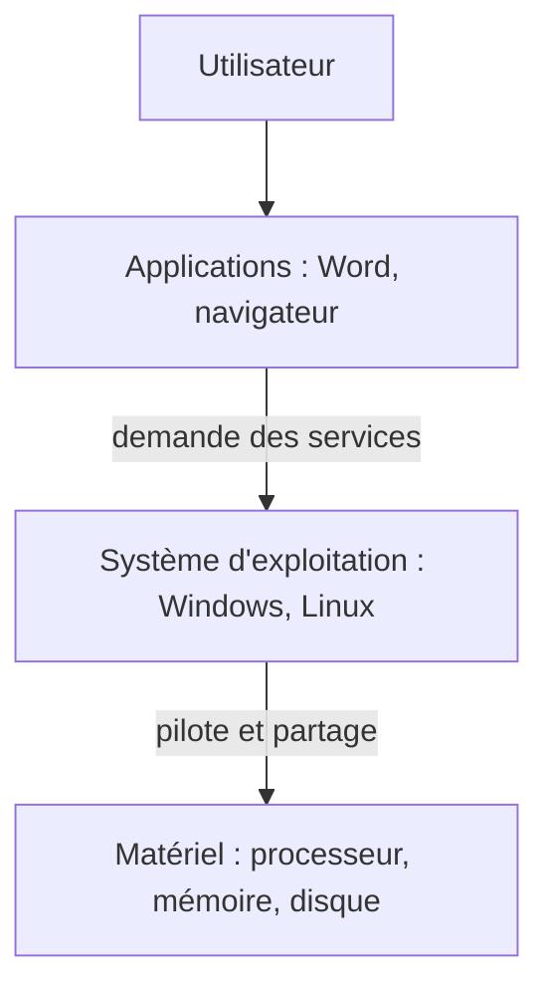

# Cours – Architecture matérielle du PC

*BTS SIO SISR 1re année – Bloc 2 – S01 – à lire avant le [TP](02-tp.md)*

> [!NOTE] Ce que tu dois savoir déjà
> - **Prérequis :** savoir utiliser un ordinateur (allumer, ouvrir des fichiers, naviguer sur le web). Aucune connaissance technique n'est supposée.
> - **Expliqués dans ce cours :** les composants d'un PC, la différence entre matériel et logiciel, le rôle du système d'exploitation. Le [cours suivant](01b-cours-serveur.md) traite du serveur, de la connectique et du BIOS/UEFI.

## À la fin de ce cours, tu sauras

- [ ] distinguer le **matériel** (hardware) du **logiciel** (software) ;
- [ ] nommer les **composants essentiels** d'un PC et dire à quoi sert chacun ;
- [ ] comparer un **disque dur (HDD)** et un **SSD** ;
- [ ] expliquer le rôle du **système d'exploitation** entre les applications et le matériel ;
- [ ] relier l'identification du matériel à la **gestion du parc** (inventaire, CMDB).

---

## 1. Pourquoi ouvrir un PC ?

Un technicien systèmes et réseaux doit pouvoir **diagnostiquer une panne matérielle**, **faire évoluer un poste** (ajouter de la mémoire, changer un disque), **inventorier le parc** et **conseiller** sur les évolutions à prévoir.

> [!TIP]
> **Lien avec la gestion de parc.** Une base de gestion des configurations (CMDB) n'est utile que si elle est à jour. Tout commence par l'identification précise du matériel : c'est l'objet de la fiche d'inventaire du TP.

## 2. Matériel et logiciel

| | Matériel (*hardware*) | Logiciel (*software*) |
|---|---|---|
| **Définition** | Les pièces physiques que l'on peut toucher | Les programmes et les données, immatériels |
| **Exemples** | Processeur, mémoire, disque, carte mère, alimentation | Système d'exploitation, applications, pilotes |

Les deux sont indissociables : un logiciel ne fonctionne pas sans matériel, et un matériel sans logiciel ne sert à rien.

*Chaque couche utilise les services de la couche du dessous.*

## 3. Les composants essentiels

### La carte mère

Elle **interconnecte** tous les composants. Repères à connaître :

| Élément | Rôle |
|---|---|
| **Socket** | Emplacement du processeur |
| **Slots DIMM** | Emplacements des barrettes de mémoire vive |
| **Slots PCIe** | Cartes d'extension (graphique, réseau, stockage) |
| **Connecteurs SATA** et **M.2** | Disques durs, SSD |
| **Connecteur d'alimentation** | Prise 24 broches reliée au bloc d'alimentation |
| **Chipset** | Puces qui gèrent les échanges entre composants |
| **Pile CMOS** | Pile bouton qui conserve l'heure et les réglages du BIOS/UEFI |

### Le processeur (CPU)

Il **exécute les instructions** des programmes. Ses caractéristiques : la **marque et la gamme** (Intel Core, AMD Ryzen), la **fréquence** en GHz, le nombre de **cœurs** (tâches réellement simultanées) et de **threads**. Il est souvent caché sous un ventirad (ventilateur et radiateur).

> [!WARNING]
> Le processeur est fragile (broches ou contacts) et sensible à la chaleur : ne le manipule jamais sans précaution, et ne le remets jamais en route sans pâte thermique ni ventirad.

### La mémoire vive (RAM)

Mémoire **temporaire et très rapide** où l'ordinateur place ce qu'il utilise en ce moment. Elle est **volatile** : tout est perdu quand on éteint. Repères : le **type** (DDR4, DDR5 : plus le chiffre est grand, plus la génération est récente), la **capacité** (8, 16, 32 Go) et la **fréquence** (MHz).

### Le stockage : HDD ou SSD

| Critère | Disque dur (HDD) | SSD |
|---|---|---|
| **Technologie** | Plateaux magnétiques en rotation | Mémoire flash, sans pièce mobile |
| **Vitesse** | Limitée par la mécanique | Beaucoup plus rapide |
| **Résistance aux chocs, bruit** | Fragile, audible | Résistant, silencieux |
| **Prix au Go** | Faible | Plus élevé |
| **Formats courants** | 3,5" (fixe), 2,5" (portable) | 2,5" SATA, M.2 (SATA ou NVMe) |

Une configuration fréquente : **SSD pour le système et les programmes**, **HDD pour le stockage de masse**.

> [!NOTE]
> Les ordres de grandeur de vitesse et de prix changent vite : relève toujours les valeurs sur la fiche technique du composant plutôt que de t'appuyer sur un tableau de cours.

### L'alimentation (PSU)

Elle **convertit le courant du secteur** (alternatif) en tensions continues utilisables par les composants (12 V, 5 V, 3,3 V). Sa **puissance** (en watts) doit couvrir la consommation de l'ensemble ; la certification **80 Plus** indique son rendement.

> [!WARNING]
> Ne jamais ouvrir une alimentation : ses condensateurs peuvent rester chargés, même débranchée.

### La carte graphique (GPU)

Elle calcule l'image envoyée à l'écran. Elle est soit **intégrée** au processeur (suffisante pour la bureautique), soit **dédiée** (carte sur un slot PCIe x16, utile pour le montage vidéo, la 3D, le calcul).

### Le boîtier

Il protège les composants et organise le **refroidissement** (entrée d'air à l'avant, extraction à l'arrière). Formats courants : Mini-ITX, Micro-ATX, ATX.

**Je vérifie.** Un utilisateur se plaint que son poste « perd ce qu'il écrivait » à chaque coupure de courant. Quel composant te vient à l'esprit ? Et pourquoi un fichier enregistré, lui, est conservé ?

Voir la réponse

La **RAM** est volatile : le document non enregistré n'existe qu'en mémoire vive. Un fichier **enregistré** est écrit sur le **stockage** (HDD ou SSD), qui conserve les données sans alimentation.

## 4. Du code machine à l'application

Un processeur ne comprend que des instructions en **binaire** (le *code machine*), illisibles pour un humain. On a donc empilé des couches :

1. le **code machine**, directement exécuté par le processeur ;
2. le **système d'exploitation** (Windows, Linux, macOS), intermédiaire entre le matériel et les applications ;
3. les **applications** (bureautique, navigateur, messagerie) que l'utilisateur emploie.

Le système d'exploitation assure la **gestion du matériel**, des **fichiers**, des **processus**, l'**interface** (graphique ou en ligne de commande) et la **sécurité** (comptes et droits). Quand Word « enregistre un fichier », il demande ce service à Windows, qui le traduit en instructions pour le contrôleur de disque.

**Je vérifie.** Où se trouve, dans la pile « utilisateur – application – système – matériel », le pilote (*driver*) d'une imprimante ?

Voir la réponse

Le pilote est un **logiciel** qui permet au **système d'exploitation** de communiquer avec un matériel précis : il se place entre le système et le matériel.

## À retenir

- Le **matériel** se touche, le **logiciel** non ; ils ne fonctionnent qu'ensemble.
- **RAM = mémoire de travail, volatile** ; **stockage = mémoire durable**.
- Le **système d'exploitation** cache la complexité du matériel aux applications.
- Identifier précisément le matériel est la **première étape de la gestion de parc**.
