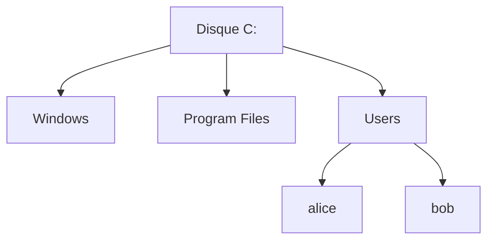

# Cours – Système d'exploitation, comptes et permissions NTFS

*BTS SIO SISR 1re année – Bloc 2 – S02 – à lire avant le [TP](02-tp.md)*

> [!NOTE] Ce que tu dois savoir déjà
> - **Prérequis :** S01 : installer une VM Windows.
> - **Matériel :** VM Windows 10/11 (S01).

## À la fin de ce cours, tu sauras

- [ ] **Expliquer** le rôle d'un système d'exploitation et **comparer** Windows, Linux et macOS en entreprise ;
- [ ] **Créer** et **gérer** des comptes locaux, **distinguer** administrateur et utilisateur standard ;
- [ ] **Configurer** les permissions NTFS sur un dossier et **lire** les permissions effectives ;
- [ ] **Appliquer** le principe du moindre privilège ;
- [ ] **Différencier** compte local et compte de domaine (introduction à Active Directory).

---

## I. Le Système d'Exploitation : Chef d'Orchestre de l'Ordinateur

### A. Définition et Rôle

**Définition :** Le **Système d'Exploitation** (Operating System / OS) est un ensemble de programmes qui assure la **liaison entre le matériel et les applications**, tout en fournissant une **interface utilisateur**.

**Analogie :** L'OS est comme le **chef d'orchestre** d'un concert :
- Les **musiciens** = composants matériels (CPU, RAM, disques...)
- La **partition** = les applications (Word, Chrome, Photoshop...)
- Le **chef d'orchestre** = l'OS qui coordonne tout et décide qui joue quand

Sans OS, un ordinateur est comme une voiture sans moteur : le matériel est là, mais rien ne fonctionne.

---

### B. Les 5 Rôles Principaux d'un OS

#### **1. Gestion du Matériel (Hardware Management)**

L'OS contrôle tous les composants matériels via des **pilotes (drivers)**.

**Exemples :**
- Envoyer les données à imprimer vers l'imprimante
- Lire et écrire des données sur le disque dur
- Gérer l'affichage sur l'écran via la carte graphique
- Détecter les clés USB branchées

 **Lien avec S01 :** rappelez-vous les composants (CPU, RAM, SSD) vus en S01 → c'est l'OS qui les pilote !

---

#### **2. Gestion des Fichiers (File System Management)**

L'OS organise les données en **fichiers** et **dossiers** (hiérarchie arborescente).

**Concepts clés :**
- **Système de fichiers** : NTFS (Windows), ext4 (Linux), APFS (macOS)
- **Arborescence** : Racine C:\ → Dossiers → Sous-dossiers → Fichiers
- **Métadonnées** : Nom, taille, date de création, propriétaire, permissions

**Opérations gérées :**
- Créer, copier, déplacer, renommer, supprimer des fichiers
- Rechercher des fichiers
- Sauvegarder et restaurer des données


*Arborescence typique de Windows : la racine du disque `C:`, les dossiers du système et les dossiers personnels sous `Users`.*
---

#### **3. Gestion des Processus (Process Management)**

Un **processus** = un programme en cours d'exécution.

**Rôle de l'OS :**
- **Multitâche** : Exécuter plusieurs programmes simultanément (Chrome + Word + Spotify...)
- **Allocation du CPU** : Décider quel processus utilise le CPU et pendant combien de temps
- **Gestion de la RAM** : Allouer de la mémoire à chaque processus
- **Priorités** : Les processus système ont la priorité sur les applications

**Outil Windows :** **Gestionnaire des tâches** (Ctrl+Shift+Esc)
- Onglet "Processus" : voir tous les programmes en cours
- Onglet "Performances" : voir l'utilisation CPU, RAM, disque, réseau

---

#### **4. Gestion des Utilisateurs et des Droits (User Management & Security)**

 **THÈME CENTRAL DE CETTE SÉANCE**

L'OS permet de créer des **comptes utilisateurs** avec des **droits différenciés**.

**Pourquoi ?**
- ✅ **Sécurité** : Empêcher les utilisateurs de modifier les fichiers système
- ✅ **Confidentialité** : Chacun a son espace personnel (Bureau, Documents...)
- ✅ **Traçabilité** : Savoir qui a fait quoi (logs, audits)
- ✅ **Conformité RGPD** : Article 32 impose des mesures de sécurité dont la gestion des droits

**Mécanismes :**
- **Authentification** : Vérifier l'identité (nom d'utilisateur + mot de passe)
- **Autorisation** : Déterminer ce que l'utilisateur peut faire (permissions)
- **Audit** : Enregistrer les actions (qui a accédé à quoi, quand)

 Nous approfondirons ce point dans les sections II et III.

---

#### **5. Interface Utilisateur (User Interface)**

L'OS fournit un moyen d'interagir avec l'ordinateur.

**Types d'interfaces :**

| **Type** | **Nom** | **Description** | **Exemple** |
|----------|---------|-----------------|-------------|
| **CLI** | Command Line Interface | Lignes de commande (texte uniquement) | CMD, PowerShell, Bash (Linux) |
| **GUI** | Graphical User Interface | Interface graphique (fenêtres, icônes, souris) | Windows 10/11, macOS, GNOME (Linux) |
| **TUI** | Text-based User Interface | Interface texte avancée (menus texte) | Nano (éditeur Linux), BIOS/UEFI |

**Avantages CLI (pour les techniciens) :**
- ✅ Plus rapide pour les tâches répétitives (scripts)
- ✅ Administration à distance (SSH)
- ✅ Automatisation (batch, PowerShell, Bash)

**Avantages GUI (pour les utilisateurs finaux) :**
- ✅ Intuitif et visuel
- ✅ Courbe d'apprentissage plus douce
- ✅ Découverte des fonctionnalités par exploration

 **Bon technicien SISR = maîtrise des deux interfaces !**

---

### C. Les Principaux Systèmes d'Exploitation

#### **Tableau Comparatif**

| **OS** | **Éditeur** | **Licence** | **Usage Principal** | **Parts de Marché** |
|--------|-------------|-------------|---------------------|---------------------|
| **Windows** | Microsoft | Propriétaire (payant) | Desktop (bureautique, jeux), Serveurs | ~73% desktop, ~70% serveurs (avec Linux) |
| **Linux** | Communauté / Red Hat / Canonical... | Open Source (gratuit) | Serveurs, embarqué, supercalculateurs | ~26% serveurs, ~3% desktop |
| **macOS** | Apple | Propriétaire (inclus avec Mac) | Desktop (création, développement) | ~15% desktop |
| **Android** | Google | Open Source (base Linux) | Smartphones, tablettes | ~70% mobile |
| **iOS** | Apple | Propriétaire | iPhone, iPad | ~27% mobile |

---

#### **Windows : L'Incontournable en Entreprise**

**Versions :**
- **Client** : Windows 10, Windows 11 (postes de travail)
- **Serveur** : Windows Server 2016/2019/2022 (infrastructure)

**Points forts :**
- ✅ **Compatibilité** : Majorité des logiciels professionnels (Office, ERP, CRM...)
- ✅ **Active Directory** : Gestion centralisée des utilisateurs et machines
- ✅ **Support** : Assistance Microsoft, documentation abondante
- ✅ **Familiarité** : Interface connue par 90% des utilisateurs

**Points faibles :**
- ❌ **Coût** : Licences payantes (Windows + CAL + applications)
- ❌ **Sécurité** : Cible privilégiée des malwares (vulnérabilités fréquentes)
- ❌ **Lourdeur** : Consomme plus de ressources que Linux

**Cas d'usage typiques :**
- Postes de travail bureautiques dans PME/ETI/Grands Comptes
- Serveurs de fichiers (File Server)
- Serveurs d'applications métier (.NET, SQL Server)
- Contrôleurs de domaine (Active Directory)

---

#### **Linux : Le Roi des Serveurs**

**Distributions principales :**
- **Debian** / **Ubuntu** : Serveurs web, cloud
- **Red Hat Enterprise Linux (RHEL)** / **CentOS** : Entreprises (support commercial)
- **Fedora** : Workstations développeurs
- **Arch Linux** : Utilisateurs avancés (personnalisation maximale)

**Points forts :**
- ✅ **Gratuit** : Pas de licence (économie majeure)
- ✅ **Stabilité** : Serveurs Linux avec uptimes de plusieurs années
- ✅ **Sécurité** : Moins de malwares, permissions strictes par défaut
- ✅ **Légèreté** : Fonctionne sur du matériel ancien
- ✅ **Flexibilité** : Personnalisable à l'extrême (choix GUI, services...)

**Points faibles :**
- ❌ **Courbe d'apprentissage** : CLI obligatoire pour administration
- ❌ **Compatibilité logicielle** : Certains logiciels métier Windows-only
- ❌ **Fragmentation** : Des dizaines de distributions différentes

**Cas d'usage typiques :**
- Serveurs web (Apache, Nginx)
- Serveurs de bases de données (MySQL, PostgreSQL)
- Infrastructure cloud (AWS, Azure, Google Cloud)
- Conteneurs (Docker, Kubernetes)
- Objets connectés (Raspberry Pi, routeurs, NAS...)

---

#### **macOS : Créatif et Développeur**

**Points forts :**
- ✅ **Écosystème Apple** : Intégration iPhone/iPad/Mac
- ✅ **Création** : Applications pro (Final Cut, Logic Pro, Xcode)
- ✅ **Base Unix** : Terminal Bash/Zsh pour développeurs
- ✅ **Sécurité** : Gatekeeper, XProtect (antimalware intégré)

**Points faibles :**
- ❌ **Prix** : Matériel Apple très cher
- ❌ **Fermeture** : Impossible d'installer sur PC standard (hackintosh = violation licence)
- ❌ **Peu en entreprise** : Marginal en environnement corporate (sauf créa/dev)

**Cas d'usage typiques :**
- Studios de création graphique / vidéo / audio
- Agences de développement mobile (apps iOS)
- Startups tech (culture développeur)

---

### D. Architecture d'un OS : Le Noyau (Kernel)

**Définition :** Le **noyau** (kernel) est le **cœur de l'OS**, programme qui s'exécute en **mode privilégié** (accès direct au matériel).

**Rôles du noyau :**
- Gestion des processus (scheduler)
- Gestion de la mémoire (RAM)
- Gestion des périphériques (drivers)
- Gestion des entrées/sorties (I/O)

**Types de noyaux :**

| **Type** | **Description** | **Exemple** |
|----------|-----------------|-------------|
| **Monolithique** | Tout dans un seul programme (performances max) | Linux, Unix |
| **Micro-noyau** | Noyau minimal + services séparés (stabilité max) | Minix, QNX |
| **Hybride** | Compromis (performance + modularité) | Windows NT, macOS (XNU) |

**Schéma en couches :**

```
┌────────────────────────────────────────┐
│     UTILISATEUR & APPLICATIONS         │  ← Couche 4 : Programmes (Word, Chrome...)
├────────────────────────────────────────┤
│     INTERFACE SYSTÈME (API)            │  ← Couche 3 : API Windows / POSIX
├────────────────────────────────────────┤
│     SERVICES SYSTÈMES                  │  ← Couche 2 : Gestionnaire fichiers, réseau...
├────────────────────────────────────────┤
│     NOYAU (KERNEL)                     │  ← Couche 1 : Cœur de l'OS
├────────────────────────────────────────┤
│     MATÉRIEL (HARDWARE)                │  ← Couche 0 : CPU, RAM, Disques, Cartes réseau
└────────────────────────────────────────┘
```

 **Privilèges :**
- **Mode noyau** (kernel mode) : Accès total au matériel (réservé à l'OS)
- **Mode utilisateur** (user mode) : Accès restreint via API (applications)

Cette séparation empêche une application malveillante de crasher tout le système ou d'accéder directement au matériel.

---

## II. Gestion des Comptes Utilisateurs dans Windows

### A. Pourquoi Plusieurs Comptes Utilisateurs ?

**Scénario sans comptes séparés (ordinateur partagé avec 1 seul compte) :**

❌ **Problèmes :**
1. Pas de **confidentialité** : Tout le monde voit les documents de tout le monde
2. Pas de **personnalisation** : Fond d'écran, favoris, applications... partagés
3. **Sécurité catastrophique** : Si ce compte unique est Administrateur, n'importe qui peut installer des logiciels malveillants ou supprimer des fichiers système
4. **Aucune traçabilité** : Impossible de savoir qui a supprimé le fichier important

**Scénario avec comptes séparés :**

✅ **Avantages :**
1. **Confidentialité** : Chaque utilisateur a son dossier personnel (C:\Users\nomutilisateur\)
2. **Personnalisation** : Bureau, thème, paramètres propres à chacun
3. **Sécurité** : Comptes limités ne peuvent pas installer de logiciels ou modifier le système
4. **Traçabilité** : Les logs indiquent quel compte a effectué quelle action
5. **Conformité RGPD** : Séparation des accès = mesure de sécurité obligatoire

---

### B. Types de Comptes dans Windows

#### **1. Compte Administrateur (Administrator)**

**Privilèges :**
- ✅ **Contrôle total** du système
- ✅ Installer/désinstaller des programmes
- ✅ Modifier les paramètres système
- ✅ Créer/supprimer des comptes utilisateurs
- ✅ Modifier les permissions de fichiers
- ✅ Accéder aux fichiers de tous les utilisateurs
- ✅ Installer des pilotes matériels

**Icône :** Badge jaune/orange sur la photo de profil

**Danger ⚠ :**
- Un malware exécuté avec des droits admin peut **tout infecter**
- Une fausse manipulation peut **rendre Windows instable**
- Accès non contrôlé aux **données sensibles**

**Bonnes pratiques :**
- ❌ **Ne JAMAIS utiliser un compte Administrateur au quotidien**
- ✅ Créer un compte Utilisateur standard pour l'usage quotidien
- ✅ Utiliser l'Administrateur uniquement pour les tâches d'administration
- ✅ Activer **UAC (User Account Control)** pour demander confirmation avant actions sensibles

---

#### **2. Compte Utilisateur Standard (Standard User)**

**Privilèges :**
- ✅ Utiliser les programmes installés
- ✅ Modifier ses propres fichiers (dans C:\Users\sonnom\)
- ✅ Personnaliser son Bureau, thème, favoris
- ✅ Se connecter à Internet
- ❌ **Ne PEUT PAS** installer de logiciels
- ❌ **Ne PEUT PAS** modifier les paramètres système
- ❌ **Ne PEUT PAS** accéder aux fichiers des autres utilisateurs

**Icône :** Pas de badge spécial

**Avantages sécurité :**
- ✅ Un malware ne peut infecter que l'espace de cet utilisateur (pas tout le système)
- ✅ Impossible de casser Windows par erreur
- ✅ Principe du **moindre privilège** respecté

**Usage recommandé :**
- ✅ **Tous les employés** d'une entreprise doivent avoir des comptes Standard
- ✅ Même l'administrateur système doit avoir un compte Standard pour son travail quotidien (et un compte Admin séparé pour l'administration)

---

#### **3. Compte Invité (Guest) - Obsolète Windows 10/11**

**Caractéristiques :**
- Compte temporaire pour visiteurs
- Aucun mot de passe requis
- Profil supprimé à chaque fermeture de session
- **Désactivé par défaut** depuis Windows 10 (raisons de sécurité)

 **Note :** Peu utilisé en entreprise. En BTS SIO, on ne le manipule généralement pas.

---

### C. Comptes Locaux vs Comptes de Domaine

#### **Compte Local**

**Définition :** Compte créé sur une **machine spécifique**, stocké dans la **base SAM** (Security Account Manager) locale de cette machine.

**Caractéristiques :**
- ✅ Fonctionne uniquement sur **cette machine**
- ✅ Pas besoin de réseau ou de serveur
- ✅ Idéal pour : PC personnels, petites structures (<5 PC), environnements de test

**Gestion :**
- Outil : **Gestion de l'ordinateur** → **Utilisateurs et groupes locaux**
- Emplacement base de données : `C:\Windows\System32\config\SAM`

**Limites :**
- ❌ Si 10 PC → il faut créer 10 fois le même compte (1 par PC) !
- ❌ Changement de mot de passe → à faire sur chaque machine
- ❌ Pas de gestion centralisée
- ❌ Pas de stratégies de groupe (GPO)

---

#### **Compte de Domaine (Active Directory)**

**Définition :** Compte créé dans **Active Directory** (annuaire centralisé sur un serveur), valable sur **toutes les machines du domaine**.

**Caractéristiques :**
- ✅ **1 seul compte** utilisable sur tous les PC de l'entreprise
- ✅ Gestion **centralisée** (création, modification, suppression depuis le serveur)
- ✅ **Stratégies de groupe (GPO)** : paramètres appliqués automatiquement
- ✅ **Authentification unique (SSO)** : 1 mot de passe pour tous les services

**Gestion :**
- Outil : **Active Directory Users and Computers (ADUC)** sur le contrôleur de domaine
- Serveur : **Windows Server** avec rôle **AD DS (Active Directory Domain Services)**

**Avantages pour l'entreprise :**
- ✅ Employé arrive → 1 compte créé → accès immédiat à tous les PC et services
- ✅ Employé part → compte désactivé en 1 clic → plus aucun accès nulle part
- ✅ Changement de mot de passe → pris en compte partout instantanément
- ✅ Stratégies : forcer écran de veille, fond d'écran entreprise, logiciels installés...

**Exemple professionnel :**

| **Scénario** | **Compte Local** | **Compte Domaine (AD)** |
|--------------|------------------|-------------------------|
| Nouvel employé (Jean Dupont) | Créer manuellement "jdupont" sur ses 3 PC de travail | Créer 1 fois "jdupont" dans AD → fonctionne sur les 500 PC de l'entreprise |
| Jean oublie son mot de passe | Réinitialiser sur chaque PC (3 fois) | Réinitialiser 1 fois dans AD → synchronisé partout |
| Jean change de service | Modifier les droits sur chaque PC manuellement | Déplacer le compte dans une autre OU (Organizational Unit) → GPO appliquées automatiquement |
| Jean quitte l'entreprise | Supprimer le compte sur les 3 PC | Désactiver le compte dans AD → bloqué partout en 10 secondes |

 **En BTS SIO :**
- **S02** : Manipulation de comptes **locaux** (Windows 10/11)
- **S10 à S12** : Mise en place d'**Active Directory** et gestion de comptes de domaine

---

### D. Création de Comptes Utilisateurs Locaux (Windows 10/11)

#### **Méthode Graphique (GUI)**

**Étapes :**

1. **Ouvrir les Paramètres**
   - Clic droit sur le bouton Démarrer → **Paramètres** (icône engrenage)
   - Ou touche Windows + I

2. **Accéder aux Comptes**
   - Clic sur **Comptes**
   - Dans le menu de gauche, clic sur **Famille et autres utilisateurs**

3. **Ajouter un Utilisateur**
   - Section "Autres utilisateurs" → **Ajouter un autre utilisateur sur ce PC**

4. **Créer un Compte Local** (pas de compte Microsoft)
   - Fenêtre "Comment cette personne va-t-elle se connecter ?"
   - Clic sur **Je ne dispose pas des informations de connexion de cette personne**
   - Puis clic sur **Ajouter un utilisateur sans compte Microsoft**

5. **Remplir les Informations**
   - **Nom d'utilisateur** : `jdupont` (convention : prenom.nom ou initiales)
   - **Mot de passe** : `Azerty123!` (respecter complexité : maj+min+chiffre+symbole)
   - **Confirmer le mot de passe** : `Azerty123!`
   - **Questions de sécurité** : Remplir les 3 questions (obligatoire)

6. **Créer**
   - Clic sur **Suivant**
   - ✅ Le compte est créé ! (Type : Utilisateur standard par défaut)

---

#### **Modifier le Type de Compte (Standard → Administrateur)**

**Si besoin de promouvoir un compte en Administrateur :**

1. Paramètres → Comptes → Famille et autres utilisateurs
2. Clic sur le compte `jdupont`
3. Clic sur **Modifier le type de compte**
4. Dans le menu déroulant, sélectionner **Administrateur**
5. Clic sur **OK**

⚠ **Attention :** Ne faire cela que si **vraiment nécessaire** (principe du moindre privilège) !

---

#### **Méthode Ligne de Commande (PowerShell)**

**Pourquoi utiliser PowerShell ?**
- ✅ Plus **rapide** pour créer plusieurs comptes
- ✅ **Automatisation** via scripts
- ✅ Administration à **distance** (WinRM)
- ✅ **Traçabilité** (commandes enregistrées dans l'historique)

**Commandes :**

```powershell
# Ouvrir PowerShell en tant qu'Administrateur
# Clic droit sur Démarrer → Windows PowerShell (admin)

# Créer un utilisateur local
New-LocalUser -Name "jdupont" -Password (ConvertTo-SecureString "Azerty123!" -AsPlainText -Force) -FullName "Jean Dupont" -Description "Comptable"

# Ajouter l'utilisateur au groupe Administrateurs (si besoin)
Add-LocalGroupMember -Group "Administrateurs" -Member "jdupont"

# Ou au groupe Utilisateurs (par défaut)
Add-LocalGroupMember -Group "Utilisateurs" -Member "jdupont"

# Lister tous les comptes locaux
Get-LocalUser

# Désactiver un compte
Disable-LocalUser -Name "jdupont"

# Réactiver un compte
Enable-LocalUser -Name "jdupont"

# Supprimer un compte
Remove-LocalUser -Name "jdupont"

# Changer le mot de passe
Set-LocalUser -Name "jdupont" -Password (ConvertTo-SecureString "NouveauMDP2024!" -AsPlainText -Force)
```

 **Conseil :** Gardez ces commandes sous la main, elles reviendront souvent en BTS et en entreprise !

---

#### **Méthode Outil Gestion de l'Ordinateur (Avancé)**

**Avantage :** Interface plus complète que les Paramètres, permet de gérer les groupes locaux.

**Étapes :**

1. Clic droit sur **Ce PC** → **Gérer**
   - Ou taper `compmgmt.msc` dans Exécuter (Windows + R)

2. **Outils système** → **Utilisateurs et groupes locaux** → **Utilisateurs**

3. Clic droit dans la zone vide → **Nouvel utilisateur...**

4. Remplir :
   - **Nom d'utilisateur** : `jdupont`
   - **Nom complet** : Jean Dupont
   - **Description** : Comptable
   - **Mot de passe** : `Azerty123!`
   - **Confirmer le mot de passe** : `Azerty123!`
   - Cocher **L'utilisateur ne peut pas changer de mot de passe** (optionnel, selon contexte)
   - Décocher **L'utilisateur doit changer le mot de passe à la prochaine ouverture de session** (pour simplifier le TP)

5. Clic sur **Créer** puis **Fermer**

**Ajouter l'utilisateur à un groupe :**

1. Toujours dans **Utilisateurs et groupes locaux** → **Groupes**
2. Double-clic sur **Administrateurs** (ou autre groupe)
3. Clic sur **Ajouter...**
4. Taper `jdupont` → Clic sur **Vérifier les noms** → OK
5. OK pour valider

✅ L'utilisateur est maintenant membre du groupe Administrateurs.

---

### E. Groupes Locaux Prédéfinis

**Définition :** Un **groupe** est un ensemble d'utilisateurs partageant les **mêmes droits**. Au lieu de donner des droits individuellement, on les affecte au groupe.

**Groupes Windows locaux principaux :**

| **Groupe** | **Description** | **Privilèges** |
|------------|-----------------|----------------|
| **Administrateurs** | Contrôle total du système | Tout installer, tout modifier, accès à tous les fichiers |
| **Utilisateurs** | Groupe standard | Utiliser le PC, modifier ses propres fichiers, installer apps Modern (Microsoft Store) |
| **Utilisateurs avec pouvoir** | Privilèges limités avancés | Partager des dossiers, modifier l'horloge (ancien, peu utilisé) |
| **Opérateurs de sauvegarde** | Sauvegardes système | Lire tous les fichiers (même sans permission), pour logiciels de backup |
| **Invités** | Accès temporaire minimal | Très restreint, pas de personnalisation |

**Pourquoi utiliser des groupes ?**

**Exemple :** 10 employés du service Comptabilité doivent avoir accès au dossier `C:\Compta`.

❌ **Méthode individuelle** : Ajouter les 10 comptes un par un aux permissions du dossier.
- Si 11ème employé arrive → ajouter manuellement
- Si employé part → retirer manuellement
- Risque d'oubli et d'erreur

✅ **Méthode par groupe** : 
1. Créer un groupe local "Comptables"
2. Ajouter les 10 comptes au groupe
3. Donner les permissions au **groupe** (pas aux comptes individuels)
- Nouvel employé → l'ajouter au groupe (1 manipulation) → droits automatiques
- Employé part → le retirer du groupe → droits révoqués partout

 **Gain de temps + sécurité + cohérence**

---

## III. Permissions NTFS : Contrôler l'Accès aux Fichiers

### A. Qu'est-ce que NTFS ?

**NTFS = New Technology File System**

**Définition :** Système de fichiers de Windows (depuis Windows NT 1993), offrant des fonctionnalités avancées de sécurité, fiabilité et performance.

**Avantages de NTFS vs FAT32 :**

| **Fonctionnalité** | **FAT32** (ancien) | **NTFS** (moderne) |
|--------------------|--------------------|--------------------|
| **Taille fichier max** | 4 Go | 16 Exaoctets (= illimité en pratique) |
| **Taille partition max** | 2 To | 256 To |
| **Permissions fichiers** | ❌ Non (tous les fichiers accessibles par tous) | ✅ Oui (ACL - Access Control Lists) |
| **Chiffrement** | ❌ Non | ✅ Oui (EFS - Encrypting File System) |
| **Compression** | ❌ Non | ✅ Oui (transparente) |
| **Quotas disque** | ❌ Non | ✅ Oui (limiter l'espace par utilisateur) |
| **Journalisation** | ❌ Non | ✅ Oui (récupération après crash) |

 **À retenir :** NTFS est **obligatoire** pour utiliser les permissions de fichiers Windows. Une clé USB en FAT32 n'a **pas de permissions** (accessible en écriture par tous).

---

### B. Les 6 Permissions NTFS Standard

Chaque fichier ou dossier NTFS possède une **ACL (Access Control List)** : liste des utilisateurs/groupes et leurs droits.

**Les 6 permissions de base :**

| **Permission** | **Symbole** | **Peut...** | **Exemples d'actions autorisées** |
|----------------|-------------|-------------|-----------------------------------|
| **Lecture** |  R (Read) | Lire le contenu | Ouvrir un fichier, voir le contenu d'un dossier, copier un fichier |
| **Écriture** |  W (Write) | Modifier le contenu | Modifier un fichier existant, créer de nouveaux fichiers dans un dossier |
| **Lecture et exécution** | ▶ RX (Read & Execute) | Lire + exécuter | Lancer un .exe, parcourir un dossier, lire un script |
| **Modification** |  M (Modify) | Lire + Écrire + Supprimer | Tout faire sauf changer les permissions ou prendre possession |
| **Contrôle total** |  F (Full Control) | **TOUT** | Modifier, supprimer, changer les permissions, changer le propriétaire |
| **Permissions spéciales** |  | Combinaisons personnalisées | Paramètres très avancés (rarement utilisés) |

---

**Détail des permissions :**

#### **1. Lecture (Read)**

**Permet de :**
- ✅ Ouvrir et **lire** un fichier
- ✅ Lister le contenu d'un dossier
- ✅ **Copier** un fichier (la copie = lecture + écriture ailleurs)

**Ne permet PAS de :**
- ❌ Modifier le fichier
- ❌ Supprimer le fichier
- ❌ Exécuter un programme (.exe, .bat)

**Cas d'usage :** Consulter des documents en lecture seule (procédures, rapports archivés).

---

#### **2. Écriture (Write)**

**Permet de :**
- ✅ Modifier le **contenu** d'un fichier existant
- ✅ Créer de **nouveaux fichiers** dans un dossier

**Ne permet PAS (seule) de :**
- ❌ Lire le contenu (!)
- ❌ Supprimer le fichier

⚠ **Bizarrerie :** Avoir uniquement "Écriture" sans "Lecture" est rare et peu utile (on peut modifier sans voir !).

**Cas d'usage (combinée avec Lecture) :** Modifier des fichiers partagés (dossier collaboratif).

---

#### **3. Lecture et Exécution (Read & Execute)**

**Permet de :**
- ✅ Tout ce que "Lecture" permet
- ✅ **Exécuter** des programmes (.exe, .bat, .cmd, .ps1...)
- ✅ **Parcourir** les sous-dossiers (traverse folders)

**Cas d'usage :** Dossier d'applications partagées. Les utilisateurs peuvent lancer les programmes mais pas les modifier.

---

#### **4. Modification (Modify)**

**Permet de :**
- ✅ Lecture
- ✅ Écriture
- ✅ Lecture et Exécution
- ✅ **Supprimer** des fichiers et sous-dossiers

**Ne permet PAS de :**
- ❌ Changer les **permissions** du fichier/dossier
- ❌ Prendre **possession** (changer le propriétaire)

**Cas d'usage :** Dossier collaboratif où chacun peut créer, modifier, supprimer ses fichiers (mais pas bloquer les autres en changeant les droits).

 **Permission la plus courante en entreprise pour les utilisateurs standards.**

---

#### **5. Contrôle Total (Full Control)**

**Permet de :**
- ✅ **TOUT** ce que "Modification" permet
- ✅ Changer les **permissions** du fichier/dossier (ACL)
- ✅ Prendre **possession** (devenir propriétaire)
- ✅ Supprimer le fichier/dossier **même sans permission de suppression sur le contenu** (force delete)

**Danger ⚠ :**
- Un utilisateur avec Contrôle Total peut **bloquer tout le monde** (y compris les admins) en retirant tous les droits
- Il peut **supprimer** un dossier entier même si d'autres travaillent dessus

**Cas d'usage :** 
- Réservé aux **Administrateurs**
- Propriétaire du fichier (créateur)

 **Principe du moindre privilège :** Ne JAMAIS donner Contrôle Total à un utilisateur standard !

---

#### **6. Permissions Spéciales (Advanced)**

Combinaisons personnalisées des 13 permissions atomiques NTFS.

**Exemples de permissions atomiques :**
- Créer des fichiers / Écrire des données
- Créer des dossiers / Ajouter des données
- Supprimer les sous-dossiers et fichiers
- Lire les attributs étendus
- Modifier les permissions
- ...

 **Usage :** Très rare, pour des besoins très spécifiques (audits de sécurité, restrictions fines).

 **En BTS SIO SISR :** On se limite aux 5 premières permissions dans 99% des cas.

---

### C. Héritage des Permissions

**Définition :** Par défaut, un sous-dossier ou fichier **hérite** automatiquement des permissions de son dossier parent.

**Exemple :**

```
C:\Data (Permissions : Groupe "Comptables" = Modification)
  ├── Factures (Hérite : Groupe "Comptables" = Modification)
  │   └── Facture_2024.xlsx (Hérite : Groupe "Comptables" = Modification)
  └── Bilans (Hérite : Groupe "Comptables" = Modification)
```

 Si je donne "Modification" au groupe "Comptables" sur `C:\Data`, tous les sous-dossiers et fichiers héritent automatiquement de cette permission.

**Avantages :**
- ✅ **Facilité de gestion** : 1 seule configuration au sommet de l'arborescence
- ✅ **Cohérence** : Pas de risque d'oublier un sous-dossier
- ✅ **Maintenance** : Modifier en haut = répercuté partout

**Désactiver l'héritage :**

Parfois, on veut qu'un sous-dossier ait des permissions **différentes** du parent.

**Exemple :** 
- `C:\Data\Salaires` → Seuls les RH doivent y accéder (pas tout le groupe "Comptables")

**Procédure :**
1. Clic droit sur `Salaires` → **Propriétés** → Onglet **Sécurité**
2. Clic sur **Avancé**
3. Clic sur **Désactiver l'héritage**
4. Choisir :
   - **Convertir les permissions héritées en permissions explicites** (garde les permissions actuelles mais les rend modifiables)
   - **Supprimer toutes les permissions héritées** (repart de zéro)
5. OK → Le dossier a maintenant ses propres permissions, indépendantes du parent

⚠ **Attention :** Désactiver l'héritage partout = gestion cauchemar ! À utiliser avec parcimonie, uniquement pour des dossiers vraiment sensibles.

---

### D. Principe du Refus Explicite (Deny)

**Deny (Refuser) vs Allow (Autoriser) :**

Chaque permission peut être **Autorisée** ou **Refusée**.

**Règle d'or :** **Deny l'emporte toujours sur Allow**.

**Exemple :**
- Utilisateur "jdupont" est membre de 2 groupes :
  - Groupe "Comptables" → **Autorise** Modification sur `C:\Data`
  - Groupe "Stagiaires" → **Refuse** Écriture sur `C:\Data`

 Résultat : "jdupont" a **Lecture seule** (le Refus annule l'autorisation d'écriture).

**Cas d'usage du Deny :**
- ✅ Bloquer un utilisateur spécifique sans le retirer d'un groupe
- ✅ Exceptions dans une politique générale

**Piège :**
- ❌ Overuse de Deny = gestion complexe et bugs difficiles à déboguer
- ✅ **Bonne pratique :** Utiliser principalement Allow, et Deny **très rarement** (cas exceptionnels)

---

### E. Permissions Effectives (Effective Permissions)

**Problème :** Un utilisateur est souvent membre de **plusieurs groupes**. Comment savoir quels sont ses droits réels ?

**Règle de cumul :**
1. Les permissions **Allow** de tous les groupes **s'additionnent** (cumul)
2. Le **Deny** de n'importe quel groupe **annule** tout

**Exemple :**

| **Groupe** | **Permission sur C:\Projets** |
|------------|-------------------------------|
| Développeurs | Lecture |
| Chefs de projet | Modification |
| Stagiaires | *Pas de permission* |

**Utilisateur "mleroux" est membre de :**
- Développeurs
- Chefs de projet

 **Permissions effectives de mleroux** : **Modification** (la plus permissive entre Lecture et Modification)

---

**Outil Windows pour vérifier les permissions effectives :**

1. Clic droit sur le dossier → **Propriétés** → **Sécurité**
2. Clic sur **Avancé**
3. Onglet **Accès effectif**
4. Clic sur **Sélectionner un utilisateur**
5. Taper le nom d'utilisateur (ex: `jdupont`) → **OK**
6. Windows affiche la liste des permissions effectives (cochées ou non)

---

### F. Configurer les Permissions NTFS (Méthode Graphique)

#### **Méthode Simple (Interface Sécurité)**

**Étapes :**

1. **Créer le dossier**
   - Exemple : `C:\Data\Comptabilite`

2. **Clic droit** sur le dossier → **Propriétés**

3. Onglet **Sécurité**
   - Affiche la liste des utilisateurs/groupes ayant des permissions
   - Affiche leurs permissions (cases cochées)

4. **Ajouter un utilisateur/groupe**
   - Clic sur **Modifier...**
   - Clic sur **Ajouter...**
   - Taper le nom (ex: `Comptables` ou `jdupont`)
   - Clic sur **Vérifier les noms** (souligne si trouvé)
   - Clic sur **OK**

5. **Définir les permissions**
   - Sélectionner l'utilisateur/groupe dans la liste
   - Cocher les permissions dans la section du bas :
     - ✅ **Contrôle total** (rarement, admins uniquement)
     - ✅ **Modification** (usage courant)
     - ✅ **Lecture et exécution** (consultations)
     - ✅ **Lecture** (lecture seule)
     - ✅ **Écriture** (rare seule)
   - Ou cocher **Refuser** pour bloquer (rare)

6. **Appliquer** → **OK**

✅ Les permissions sont configurées !

**Test des permissions :**
- Se déconnecter de Windows
- Se connecter avec le compte "jdupont"
- Essayer d'accéder au dossier `C:\Data\Comptabilite`
- Vérifier qu'on peut lire, écrire, ou que l'accès est refusé selon les permissions

---

#### **Méthode Avancée (Permissions Avancées)**

Pour aller plus loin (désactiver héritage, permissions spéciales...) :

1. Clic droit sur le dossier → **Propriétés** → **Sécurité**
2. Clic sur **Avancé**
3. Fenêtre "Paramètres de sécurité avancés" :
   - Onglet **Permissions** : Liste complète avec héritage visible
   - Bouton **Désactiver l'héritage** : Casser la chaîne d'héritage
   - Bouton **Ajouter** : Ajouter une entrée de permission (ACE - Access Control Entry)
   - Double-clic sur une ligne : Voir les 13 permissions atomiques détaillées

---

### G. Scénario Professionnel Complet (TP)

**Contexte :** PME **TechPro SARL** avec 4 services.

**Structure de dossiers à créer :**

```
C:\Data
  ├── Direction
  ├── Comptabilite
  ├── Commercial
  ├── Technique
  └── Commun
```

**Groupes à créer :**
- `GRP_Direction` (1 membre : Mme Martin)
- `GRP_Comptabilite` (2 membres : M. Dubois, Mme Leroy)
- `GRP_Commercial` (3 membres : M. Bernard, Mme Petit, M. Dupuis)
- `GRP_Technique` (2 membres : M. Garcia, Mme Roux)

**Matrice de permissions :**

| **Dossier** | **GRP_Direction** | **GRP_Comptabilite** | **GRP_Commercial** | **GRP_Technique** | **Utilisateurs** |
|-------------|-------------------|----------------------|--------------------|--------------------|------------------|
| **Direction** | Modification | ❌ Aucun | ❌ Aucun | ❌ Aucun | Lecture seule (pour organigramme) |
| **Comptabilite** | Lecture seule | Modification | ❌ Aucun | ❌ Aucun | ❌ Aucun |
| **Commercial** | Lecture seule | ❌ Aucun | Modification | ❌ Aucun | ❌ Aucun |
| **Technique** | Lecture seule | ❌ Aucun | ❌ Aucun | Modification | ❌ Aucun |
| **Commun** | Modification | Lecture | Lecture | Lecture | Lecture |

**Objectifs du TP :**
1. Créer les 5 dossiers
2. Créer les 4 groupes locaux
3. Créer 8 comptes utilisateurs (répartis dans les groupes)
4. Configurer les permissions NTFS selon la matrice
5. Tester avec chaque compte que les accès sont corrects

 Détail complet dans la section **TP Guidé Partie 2** ci-dessous.
