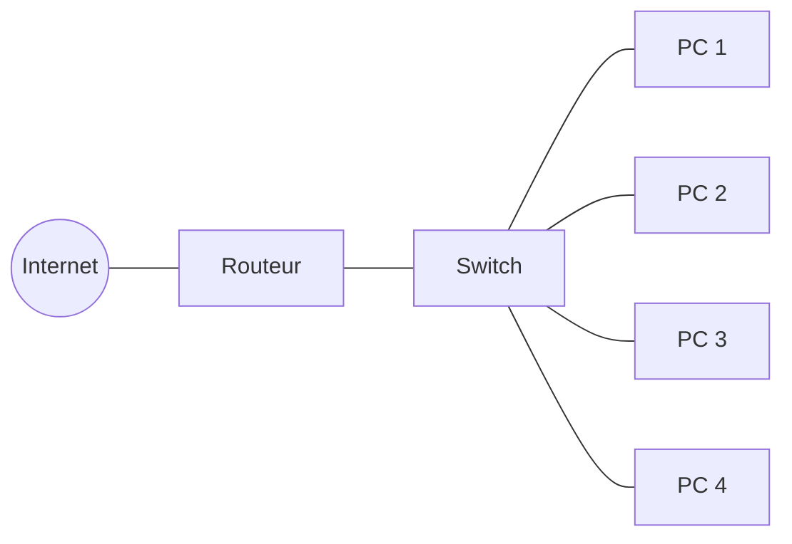
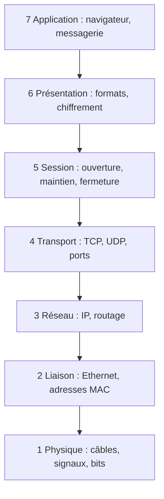
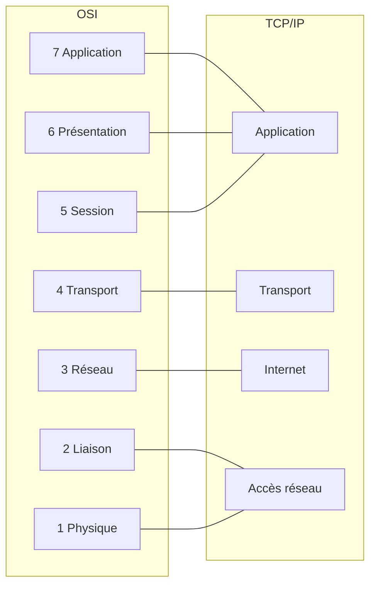
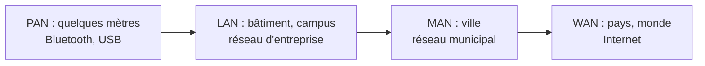

# Cours – Les fondamentaux du réseau

*BTS SIO SISR 1re année – Bloc 2 – S03 – à lire avant le [TP](02-tp.md)*

> [!NOTE] Ce que tu dois savoir déjà
> - **Prérequis :** S01 (connectique RJ45).
> - **Matériel :** Postes Windows, simulateur réseau, Wireshark.

## À la fin de ce cours, tu sauras

- [ ] **Décrire** les composants d'un réseau (carte réseau, switch, routeur) et les **types** de réseaux (PAN, LAN, MAN, WAN) ;
- [ ] **Expliquer** le modèle OSI (7 couches) et le modèle TCP/IP (4 couches) ;
- [ ] **Lire** une adresse IPv4 et son masque ;
- [ ] **Utiliser** `ping`, `ipconfig`, `tracert`, `nslookup` pour diagnostiquer ;
- [ ] **Capturer** quelques trames avec Wireshark et **repérer** les adresses MAC et IP.

---

## I. Introduction : Qu'est-ce qu'un Réseau Informatique ?

### A. Définition

**Réseau informatique** = Ensemble d'**équipements interconnectés** permettant l'**échange de données** (fichiers, messages, vidéos...).

**Analogie :** Un réseau informatique est comme le **réseau routier** :
- Les **routes** = câbles réseau (RJ45, fibre)
- Les **voitures** = données (paquets)
- Les **carrefours** = switchs et routeurs
- Les **panneaux** = protocoles (règles de circulation)
- Les **adresses** = adresses IP

---

### B. Composants de Base d'un Réseau

| **Composant** | **Rôle** | **Analogie** | **Exemple** |
|---------------|----------|--------------|-------------|
| **Hôte** (Host) | Machine connectée (PC, serveur, smartphone, imprimante) | Maison avec adresse | PC portable, serveur web |
| **Câble réseau** | Support physique de transmission | Route | Câble RJ45 (cuivre), fibre optique |
| **Carte réseau** (NIC) | Interface permettant la connexion au réseau | Porte d'entrée de la maison | Carte Ethernet, Wi-Fi |
| **Switch** | Équipement reliant plusieurs machines dans un réseau local | Rond-point local (quartier) | Switch 24 ports Cisco |
| **Routeur** | Équipement reliant plusieurs réseaux entre eux | Autoroute inter-villes | Box Internet, routeur Cisco |
| **Point d'accès Wi-Fi** | Permet connexion sans fil | Route sans goudron (radio) | Borne Wi-Fi d'entreprise |


*Un réseau local simple : quatre PC reliés à un switch, lui-même connecté à un routeur (accès Internet).*
---

### C. Pourquoi Mettre en Réseau ?

**Avantages :**

1. ✅ **Partage de ressources**
   - Fichiers (serveur de fichiers)
   - Imprimantes (imprimante réseau)
   - Connexion Internet (routeur partagé)
   - Applications (logiciels métier centralisés)

2. ✅ **Communication**
   - Emails, messagerie instantanée
   - Visioconférence
   - Partage d'informations en temps réel

3. ✅ **Centralisation**
   - Données stockées sur serveurs (sauvegardes facilitées)
   - Administration centralisée (Active Directory vu plus tard)

4. ✅ **Économies**
   - 1 imprimante pour 10 personnes (vs 10 imprimantes)
   - 1 connexion Internet partagée

**Inconvénients :**

1. ❌ **Complexité** : Plus difficile à configurer et maintenir qu'un PC isolé
2. ❌ **Sécurité** : Point d'entrée pour les attaques (malwares, intrusions)
3. ❌ **Dépendance** : Si le réseau tombe, tous les utilisateurs sont bloqués
4. ❌ **Coût initial** : Équipements réseau (switchs, routeurs, câblage)

---

## II. Le Modèle OSI : Les 7 Couches

### A. Pourquoi un Modèle en Couches ?

Pour communiquer, deux machines doivent respecter des **règles communes** (protocoles).

Plutôt que d'avoir un seul gros programme gérant tout (impossible à maintenir), on découpe en **7 couches indépendantes**.

**Avantages du découpage en couches :**
- ✅ **Modularité** : Changer une couche sans toucher aux autres (ex: passer d'Ethernet à Wi-Fi)
- ✅ **Standardisation** : Différents constructeurs peuvent fabriquer des équipements compatibles
- ✅ **Simplicité** : Chaque couche a un rôle précis et limité

---

### B. Les 7 Couches OSI (Open Systems Interconnection)

**Mnémotechnique pour retenir l'ordre (de bas en haut) :**
> **"P**lease **D**o **N**ot **T**hrow **S**ausage **P**izza **A**way"

| **N°** | **Couche** | **Rôle** | **Protocoles / Technologies** | **Unité de Données** |
|--------|------------|----------|-------------------------------|---------------------|
| **7** | **Application** | Interface avec l'utilisateur (applications) | HTTP, FTP, SMTP, DNS, DHCP | **Données** (Data) |
| **6** | **Présentation** | Formatage, encodage, chiffrement, compression | JPEG, MP3, SSL/TLS, ASCII | **Données** |
| **5** | **Session** | Gestion des sessions (ouverture, maintien, fermeture) | NetBIOS, RPC | **Données** |
| **4** | **Transport** | Fiabilité, découpage en segments, contrôle de flux | **TCP**, **UDP** | **Segment** (TCP) / **Datagramme** (UDP) |
| **3** | **Réseau** | Adressage logique, routage | **IP**, ICMP, ARP | **Paquet** (Packet) |
| **2** | **Liaison** | Adressage physique, détection d'erreurs | **Ethernet**, Wi-Fi, PPP | **Trame** (Frame) |
| **1** | **Physique** | Transmission des bits (signaux électriques/optiques) | Câbles RJ45, fibre, ondes radio | **Bit** |


*Les 7 couches du modèle OSI, de l'application (en haut) au câble (en bas).*
---

### C. Détail de Chaque Couche

#### **Couche 1 - Physique**

**Rôle :** Transmission des **bits** (0 et 1) sous forme de signaux physiques.

**Caractéristiques :**
- Type de signal : Électrique (cuivre), lumineux (fibre), radio (Wi-Fi)
- Vitesse de transmission : 10 Mbps, 100 Mbps, 1 Gbps, 10 Gbps...
- Type de câble : RJ45 Cat5e/Cat6, fibre monomode/multimode
- Connecteurs : RJ45, LC, SC (fibre)

**Équipements :** 
- Câbles (RJ45, fibre optique)
- Hub (répéteur) - obsolète
- Répéteur

**Exemple concret :** Le câble Ethernet RJ45 que vous branchez dans votre PC.

---

#### **Couche 2 - Liaison de Données (Data Link)**

**Rôle :** Organiser les bits en **trames**, détecter les erreurs, gérer l'accès au média (qui parle quand).

**Adressage :** **Adresse MAC** (Media Access Control)
- Format : 6 octets en hexadécimal
- Exemple : `00:1A:2B:3C:4D:5E`
- Unique au monde (gravée dans la carte réseau)
- Les 3 premiers octets = constructeur (OUI - Organizationally Unique Identifier)

**Protocoles :**
- **Ethernet** (réseau filaire)
- **Wi-Fi (802.11)** (réseau sans fil)
- **PPP** (Point-to-Point Protocol)

**Équipements :** 
- **Switch** (commutateur) - Relie les machines dans un réseau local (LAN)
- Pont (bridge)

**Exemple concret :** Un switch qui reçoit une trame destinée à l'adresse MAC `AA:BB:CC:DD:EE:FF` et l'envoie uniquement au port où se trouve cette machine.

---

#### **Couche 3 - Réseau (Network)**

**Rôle :** **Routage** des paquets entre différents réseaux. Adressage logique.

**Adressage :** **Adresse IP** (Internet Protocol)
- IPv4 : 4 octets → Exemple : `192.168.1.10`
- IPv6 : 16 octets → Exemple : `2001:0db8:85a3::8a2e:0370:7334`

**Protocoles :**
- **IP** (Internet Protocol) - Transport des paquets
- **ICMP** (Internet Control Message Protocol) - Messages d'erreur, ping
- **ARP** (Address Resolution Protocol) - Correspondance IP ↔ MAC

**Équipements :** 
- **Routeur** - Relie plusieurs réseaux (LAN, WAN, Internet)

**Exemple concret :** Votre box Internet (routeur) qui reçoit un paquet destiné à `8.8.8.8` (Google DNS) et le route vers Internet.

---

#### **Couche 4 - Transport**

**Rôle :** Assurer la **fiabilité** de la transmission (ou pas, selon le protocole). Découpage et réassemblage des données.

**Protocoles :**

| **Protocole** | **Type** | **Fiable ?** | **Usage** |
|---------------|----------|--------------|-----------|
| **TCP** | Orienté connexion | ✅ Oui (accusés réception, retransmission) | Email, Web (HTTP), transfert fichiers (FTP) |
| **UDP** | Sans connexion | ❌ Non (pas de vérification) | Streaming vidéo, VoIP, DNS, jeux en ligne |

**TCP (Transmission Control Protocol) :**
- Établit une connexion (handshake 3 étapes : SYN, SYN-ACK, ACK)
- Garantit l'ordre d'arrivée des segments
- Retransmet les segments perdus
- Plus **lent** mais **fiable**

**UDP (User Datagram Protocol) :**
- Envoie directement sans établir de connexion
- Pas de garantie de livraison
- Plus **rapide** mais **non fiable**

**Numéro de port :** Identifie l'application destinataire (0-65535)

| **Port** | **Service** | **Protocole** |
|----------|-------------|---------------|
| 20/21 | FTP (transfert fichiers) | TCP |
| 22 | SSH (connexion sécurisée) | TCP |
| 25 | SMTP (envoi email) | TCP |
| 53 | DNS (résolution noms) | UDP (et TCP) |
| 80 | HTTP (web non sécurisé) | TCP |
| 443 | HTTPS (web sécurisé) | TCP |
| 3389 | RDP (bureau à distance Windows) | TCP |

**Exemple concret :** Quand vous visitez `https://www.google.fr`, votre navigateur se connecte au port **443** du serveur Google en utilisant **TCP**.

---

#### **Couche 5 - Session**

**Rôle :** Gestion des **sessions** de communication (ouverture, maintien, fermeture).

**Protocoles :**
- NetBIOS
- RPC (Remote Procedure Call)

**Exemple concret :** Quand vous vous connectez à un site web, une session est ouverte. Si vous fermez le navigateur, la session est fermée.

 **Note :** Cette couche est souvent intégrée dans la couche Application (modèle TCP/IP simplifié).

---

#### **Couche 6 - Présentation**

**Rôle :** **Formatage**, **encodage**, **chiffrement**, **compression** des données.

**Fonctions :**
- Conversion de formats (JPEG, MP3, MPEG, ASCII, EBCDIC)
- Chiffrement/déchiffrement (SSL/TLS)
- Compression/décompression

**Exemple concret :** Quand vous accédez à un site en HTTPS, la couche Présentation chiffre les données avec SSL/TLS avant l'envoi.

 **Note :** Souvent intégrée dans la couche Application (modèle TCP/IP).

---

#### **Couche 7 - Application**

**Rôle :** Interface avec l'**utilisateur final**. Services réseau directement utilisables.

**Protocoles :**
- **HTTP/HTTPS** : Navigation web
- **FTP** : Transfert de fichiers
- **SMTP** : Envoi d'emails
- **POP3/IMAP** : Réception d'emails
- **DNS** : Résolution de noms de domaine
- **DHCP** : Attribution automatique d'adresses IP
- **Telnet/SSH** : Accès à distance

**Applications :**
- Navigateur web (Chrome, Firefox)
- Client email (Outlook, Thunderbird)
- Client FTP (FileZilla)
- Messagerie (Slack, Teams, WhatsApp)

**Exemple concret :** Quand vous tapez `www.google.fr` dans votre navigateur, c'est la couche Application qui utilise le protocole **HTTP** pour récupérer la page web.

---

### D. Processus d'Encapsulation (Émission)

Quand Alice envoie un message à Bob :

```
┌─────────────────────────────────────────────────────────┐
│ Alice (Émetteur)                                        │
├─────────────────────────────────────────────────────────┤
│ Couche 7 - Application : "Bonjour Bob"                  │
│ Couche 6 - Présentation : Chiffrement + Encodage        │
│ Couche 5 - Session : Ouverture session                  │
│ Couche 4 - Transport : Découpage en segments TCP        │
│   → En-tête TCP ajouté (ports source/dest)             │
│ Couche 3 - Réseau : En-tête IP ajouté (IP src/dest)    │
│   → Paquet IP créé                                      │
│ Couche 2 - Liaison : En-tête Ethernet ajouté (MAC)      │
│   → Trame Ethernet créée                                │
│ Couche 1 - Physique : Conversion en bits (01010...)     │
│   → Transmission sur le câble                           │
└─────────────────────────────────────────────────────────┘
           ↓ (Câble RJ45 ou Wi-Fi)
┌─────────────────────────────────────────────────────────┐
│ Bob (Récepteur) - Désencapsulation                      │
├─────────────────────────────────────────────────────────┤
│ Couche 1 - Physique : Réception des bits               │
│ Couche 2 - Liaison : Lecture MAC, retrait en-tête       │
│ Couche 3 - Réseau : Lecture IP, retrait en-tête         │
│ Couche 4 - Transport : Réassemblage segments, ACK       │
│ Couche 5 - Session : Gestion session                    │
│ Couche 6 - Présentation : Déchiffrement, décodage       │
│ Couche 7 - Application : Affichage "Bonjour Bob"        │
└─────────────────────────────────────────────────────────┘
```

 **Analogie Poupées Russes :** Chaque couche ajoute une "enveloppe" (en-tête). À l'arrivée, on retire les enveloppes une par une jusqu'au message original.

---

## III. Le Modèle TCP/IP (Modèle Internet)

### A. Différence avec OSI

Le **modèle TCP/IP** est le modèle **réellement utilisé** sur Internet. Il simplifie OSI en **4 couches**.

| **Couche TCP/IP** | **Correspond aux couches OSI** | **Protocoles Principaux** |
|-------------------|--------------------------------|---------------------------|
| **4 - Application** | 5, 6, 7 (Session, Présentation, Application) | HTTP, FTP, SMTP, DNS, DHCP |
| **3 - Transport** | 4 (Transport) | TCP, UDP |
| **2 - Internet** | 3 (Réseau) | IP, ICMP, ARP |
| **1 - Accès Réseau** | 1, 2 (Physique, Liaison) | Ethernet, Wi-Fi |


*Correspondance entre le modèle OSI (7 couches) et le modèle TCP/IP (4 couches).*
**Pourquoi deux modèles ?**
- **OSI** : Modèle théorique, pédagogique (ISO, 1984)
- **TCP/IP** : Modèle pratique, utilisé sur Internet (ARPANET, 1970s)

 **À retenir :** On enseigne OSI pour **comprendre**, on utilise TCP/IP en **pratique**.

---

## IV. Types de Réseaux

### A. Classification par Taille (Portée Géographique)

| **Type** | **Nom Complet** | **Portée** | **Exemples** |
|----------|-----------------|------------|--------------|
| **PAN** | Personal Area Network | 1-10 mètres | Bluetooth (casque ↔ smartphone), USB |
| **LAN** | Local Area Network | Bâtiment, campus (100m-1km) | Réseau d'entreprise, école, domicile |
| **MAN** | Metropolitan Area Network | Ville (10-100 km) | Réseau universitaire multi-sites, réseau municipal |
| **WAN** | Wide Area Network | Pays, continent, monde | Internet, réseau d'entreprise multi-pays |


*Les échelles de réseaux, du PAN (le plus petit) au WAN (le plus grand).*
---

### B. Classification par Topologie (Architecture Physique)

**Topologie** = Manière dont les équipements sont **physiquement reliés**.

#### **1. Topologie en Bus**

```
PC1 ──┬── PC2 ──┬── PC3 ──┬── PC4
      │         │         │
   (Câble coaxial unique)
```

**Caractéristiques :**
- ✅ Simple, économique (1 seul câble)
- ❌ Si câble coupé → tout le réseau tombe
- ❌ Collisions fréquentes (une seule machine parle à la fois)

**Usage :** Obsolète (années 1980-1990)

---

#### **2. Topologie en Étoile**

```
      PC1
       |
PC2 - SWITCH - PC3
       |
      PC4
```

**Caractéristiques :**
- ✅ Si un câble casse → seul ce PC est déconnecté
- ✅ Facilité de dépannage (isolation des pannes)
- ✅ Ajout/retrait de PC simple
- ❌ Si le switch tombe → tout le réseau tombe
- ❌ Plus de câble nécessaire

**Usage :** **Standard de fait** des réseaux locaux filaires

---

#### **3. Topologie en Anneau**

```
PC1 ── PC2
 |      |
PC4 ── PC3
```

**Caractéristiques :**
- Chaque PC est relié à deux autres (forme un anneau)
- Les données circulent dans un sens
- ❌ Si un PC tombe → tout le réseau tombe (sauf anneau double)

**Usage :** Rare (Token Ring, FDDI - obsolète)

---

#### **4. Topologie Maillée (Mesh)**

```
PC1 ─── PC2
 | \   / |
 |  \ /  |
 |  / \  |
 | /   \ |
PC3 ─── PC4
```

**Caractéristiques :**
- ✅ Redondance maximale (plusieurs chemins possibles)
- ✅ Si un lien tombe → routage automatique par un autre chemin
- ❌ Coût élevé (beaucoup de câbles)
- ❌ Complexité de configuration

**Usage :** Réseaux critiques (datacenters, opérateurs télécom), Internet (maillage partiel)

---

## V. Adressage IPv4

### A. Structure d'une Adresse IPv4

**Adresse IPv4** = Identifiant **unique** d'une machine sur un réseau IP.

**Format :** 4 octets séparés par des points (notation décimale pointée)

**Exemple :** `192.168.1.10`

**En binaire :**
```
192      .  168      .  1        .  10
11000000 .  10101000 .  00000001 .  00001010
```

**Valeurs possibles par octet :** 0 à 255 (= 2^8 = 256 valeurs)

**Nombre total d'adresses IPv4 :** 2^32 = **4 294 967 296 adresses** (~4,3 milliards)

⚠ **Problème :** Épuisement des adresses IPv4 (8 milliards d'humains, des milliards d'objets connectés) → Solution : **IPv6** (340 sextillions d'adresses !)

---

### B. Classes d'Adresses IPv4 (Historique)

Les adresses IPv4 étaient autrefois divisées en **5 classes** (A, B, C, D, E).

| **Classe** | **Plage** | **Masque par défaut** | **Usage** | **Nb d'hôtes** |
|------------|-----------|----------------------|-----------|----------------|
| **A** | 1.0.0.0 à 126.255.255.255 | 255.0.0.0 (/8) | Très grands réseaux (pays, ISP) | ~16 millions |
| **B** | 128.0.0.0 à 191.255.255.255 | 255.255.0.0 (/16) | Grandes entreprises | ~65 000 |
| **C** | 192.0.0.0 à 223.255.255.255 | 255.255.255.0 (/24) | PME, petits réseaux | 254 |
| **D** | 224.0.0.0 à 239.255.255.255 | - | **Multicast** (diffusion à groupe) | - |
| **E** | 240.0.0.0 à 255.255.255.255 | - | **Réservé** (expérimental) | - |

**Comment reconnaître la classe ?**

Regarder le **premier octet** :
- Classe A : 1-126
- Classe B : 128-191
- Classe C : 192-223
- Classe D : 224-239
- Classe E : 240-255

**Exemples :**
- `10.0.0.1` → Classe A (premier octet = 10)
- `172.16.0.1` → Classe B (premier octet = 172)
- `192.168.1.1` → Classe C (premier octet = 192)

 **Note :** Aujourd'hui, les classes sont obsolètes. On utilise **CIDR** (Classless Inter-Domain Routing) avec notation `/xx` (ex: `192.168.1.0/24`).

---

### C. Adresses Privées vs Publiques

#### **Adresses Publiques**

**Définition :** Adresses **routables sur Internet**, **uniques au monde**.

**Attribution :** Distribuées par les **RIR** (Regional Internet Registries) via les FAI (Fournisseurs d'Accès Internet).

**Exemple :** `8.8.8.8` (Google DNS), `142.250.185.78` (serveur Google)

**Coût :** Payant (ressource rare depuis épuisement IPv4)

---

#### **Adresses Privées (RFC 1918)**

**Définition :** Adresses **non routables sur Internet**, utilisables dans les réseaux **locaux** (LAN).

**Plages réservées :**

| **Classe** | **Plage Privée** | **Masque** | **Nombre d'adresses** |
|------------|------------------|------------|-----------------------|
| **A** | 10.0.0.0 à 10.255.255.255 | 255.0.0.0 (/8) | ~16 millions |
| **B** | 172.16.0.0 à 172.31.255.255 | 255.240.0.0 (/12) | ~1 million |
| **C** | 192.168.0.0 à 192.168.255.255 | 255.255.0.0 (/16) | 65 536 |

**Avantages :**
- ✅ **Gratuites** (pas besoin de payer un FAI)
- ✅ **Réutilisables** : Chaque entreprise peut utiliser `192.168.1.0/24` dans son LAN
- ✅ **Sécurité** : Pas d'accès direct depuis Internet (protection naturelle)

**Fonctionnement :**
- Les machines en réseau privé utilisent des adresses comme `192.168.1.10`
- Pour accéder à Internet, elles passent par un **routeur NAT** (Network Address Translation)
- Le routeur traduit l'adresse privée en adresse publique (celle de la box)

**Exemple :**
- Votre PC : `192.168.1.50` (privé)
- Votre box : `90.34.12.78` (public, fourni par le FAI)
- Quand vous allez sur Google, votre requête part avec l'IP `90.34.12.78` (celle de la box)
- Google ne voit jamais votre `192.168.1.50`

---

#### **Adresses Spéciales**

| **Adresse** | **Nom** | **Usage** |
|-------------|---------|-----------|
| **0.0.0.0** | Adresse invalide | Toutes les interfaces (bind serveur) |
| **127.0.0.1** | Localhost / Loopback | Boucle locale (machine elle-même) |
| **255.255.255.255** | Broadcast | Diffusion à toutes les machines du réseau |
| **169.254.x.x** | APIPA (Automatic Private IP Addressing) | Auto-assignée si pas de DHCP |

**Exemple localhost :**
- Si vous faites `ping 127.0.0.1`, vous pingez **votre propre machine** (utile pour tester la pile TCP/IP)

---

### D. Masque de Sous-Réseau (Subnet Mask)

**Définition :** Le masque indique quelle partie de l'adresse IP représente le **réseau** et quelle partie représente l'**hôte** (machine).

**Format :** 4 octets comme une adresse IP

**Exemple :** `255.255.255.0`

**En binaire :**
```
255      .  255      .  255      .  0
11111111 .  11111111 .  11111111 .  00000000

Partie réseau (1) ────────────────┘ └── Partie hôte (0)
```

**Règle :** 
- Les bits à **1** dans le masque = partie **réseau**
- Les bits à **0** dans le masque = partie **hôte**

---

**Exemple concret :**

**Adresse IP :** `192.168.1.10`
**Masque :** `255.255.255.0` (ou `/24`)

```
IP :     192.168.1.10    → 11000000.10101000.00000001.00001010
Masque : 255.255.255.0   → 11111111.11111111.11111111.00000000
         ─────────────────   ───────────────────────── ────────
         Partie RÉSEAU                                Partie HÔTE

Adresse du RÉSEAU :  192.168.1.0   (tous les bits hôte à 0)
Adresse BROADCAST : 192.168.1.255  (tous les bits hôte à 1)
Plage utilisable :   192.168.1.1 à 192.168.1.254
```

**Nombre d'hôtes utilisables :** 2^8 - 2 = **254 machines**
- `-2` car on retire l'adresse réseau (`.0`) et l'adresse broadcast (`.255`)

---

**Masques courants :**

| **Masque (décimal)** | **Notation CIDR** | **Bits Réseau** | **Bits Hôte** | **Nb Hôtes** |
|----------------------|-------------------|-----------------|---------------|--------------|
| 255.0.0.0 | /8 | 8 | 24 | ~16 millions |
| 255.255.0.0 | /16 | 16 | 16 | ~65 000 |
| 255.255.255.0 | /24 | 24 | 8 | 254 |
| 255.255.255.128 | /25 | 25 | 7 | 126 |
| 255.255.255.192 | /26 | 26 | 6 | 62 |
| 255.255.255.224 | /27 | 27 | 5 | 30 |
| 255.255.255.252 | /30 | 30 | 2 | 2 (liaison point-à-point) |

---

### E. Notion de Passerelle par Défaut (Gateway)

**Définition :** La **passerelle par défaut** (default gateway) est l'adresse IP du **routeur** permettant de sortir du réseau local pour accéder à d'autres réseaux (Internet).

**Analogie :** Si votre réseau local est un village, la passerelle est le **portail de sortie** vers l'autoroute (Internet).

**Exemple :**

Votre configuration réseau :
- **Adresse IP** : `192.168.1.50`
- **Masque** : `255.255.255.0`
- **Passerelle** : `192.168.1.1` (adresse du routeur/box)

**Fonctionnement :**
1. Vous voulez accéder à `www.google.fr` (IP `142.250.185.78`)
2. Votre PC compare : `142.250.185.78` est-il dans mon réseau `192.168.1.0/24` ?
   - Non ! (premier octet déjà différent : 142 ≠ 192)
3. Le PC envoie le paquet à la **passerelle** `192.168.1.1`
4. Le routeur route le paquet vers Internet

⚠ **Sans passerelle configurée :** Impossible d'accéder à Internet (seulement au réseau local).

---

### F. Rôle du DNS (Domain Name System)

**Problème :** Les humains retiennent mal les adresses IP (`142.250.185.78`), mais bien les noms (`www.google.fr`).

**Solution :** Le **DNS** = "Annuaire téléphonique d'Internet" qui traduit les noms en adresses IP.

**Fonctionnement :**

1. Vous tapez `www.google.fr` dans votre navigateur
2. Votre PC envoie une requête DNS au serveur DNS configuré (ex: `8.8.8.8` - Google DNS)
3. Le serveur DNS répond : `www.google.fr` = `142.250.185.78`
4. Votre PC contacte l'IP `142.250.185.78` pour récupérer la page web

**Serveurs DNS courants :**

| **Adresse IP** | **Fournisseur** |
|----------------|-----------------|
| 8.8.8.8 / 8.8.4.4 | Google Public DNS |
| 1.1.1.1 / 1.0.0.1 | Cloudflare DNS |
| 9.9.9.9 | Quad9 DNS (sécurité) |
| 208.67.222.222 / 208.67.220.220 | OpenDNS |

**Configuration :** Généralement fournie automatiquement par **DHCP**, ou configurable manuellement dans les paramètres réseau.

---

## VII. Vocabulaire Clé à Maîtriser pour l'Examen

| **Terme** | **Définition** |
|-----------|----------------|
| **Réseau informatique** | Ensemble d'équipements interconnectés permettant l'échange de données |
| **LAN** | Local Area Network - Réseau local (bâtiment, campus) |
| **WAN** | Wide Area Network - Réseau étendu (pays, monde, Internet) |
| **Switch** | Équipement reliant plusieurs machines dans un réseau local (couche 2) |
| **Routeur** | Équipement reliant plusieurs réseaux entre eux (couche 3) |
| **Protocole** | Ensemble de règles permettant la communication entre équipements |
| **Modèle OSI** | Modèle théorique en 7 couches décrivant les communications réseau |
| **Modèle TCP/IP** | Modèle pratique en 4 couches utilisé sur Internet |
| **Encapsulation** | Processus d'ajout d'en-têtes par chaque couche lors de l'envoi |
| **Désencapsulation** | Processus de retrait des en-têtes à la réception |
| **Trame** | Unité de données de la couche 2 (Liaison) |
| **Paquet** | Unité de données de la couche 3 (Réseau) |
| **Segment** | Unité de données de la couche 4 (Transport - TCP) |
| **Adresse MAC** | Adresse physique unique gravée dans une carte réseau (couche 2) |
| **Adresse IP** | Adresse logique identifiant une machine sur un réseau IP (couche 3) |
| **IPv4** | Protocole IP version 4 (4 octets, 4,3 milliards d'adresses) |
| **Masque de sous-réseau** | Indique la partie réseau et la partie hôte d'une adresse IP |
| **Passerelle par défaut** | Adresse IP du routeur permettant de sortir du réseau local |
| **DNS** | Domain Name System - Service de résolution de noms en adresses IP |
| **DHCP** | Dynamic Host Configuration Protocol - Attribution automatique d'adresses IP |
| **TCP** | Transmission Control Protocol - Protocole orienté connexion, fiable |
| **UDP** | User Datagram Protocol - Protocole non connecté, rapide mais non fiable |
| **Port** | Numéro identifiant une application (0-65535) |
| **ICMP** | Internet Control Message Protocol - Messages d'erreur et ping |
| **Ping** | Commande testant la connectivité réseau (ICMP Echo Request/Reply) |
| **Traceroute / Tracert** | Commande traçant le chemin des paquets vers une destination |
| **Loopback** | Adresse 127.0.0.1 pointant vers la machine locale |
| **Broadcast** | Adresse de diffusion vers toutes les machines du réseau |
| **Unicast** | Communication d'une machine vers une seule autre |
| **Multicast** | Communication d'une machine vers un groupe |
| **NAT** | Network Address Translation - Traduction d'adresses privées en publiques |

---

## VIII. Exercices d'Entraînement

### Exercice 1 : Identification de Classe et Masque

Pour chaque adresse IP, indiquer :
- La classe (A, B, C, D, E)
- Le masque par défaut
- Si c'est une adresse privée ou publique

| **Adresse IP** | **Classe** | **Masque par défaut** | **Privée / Publique** |
|----------------|------------|-----------------------|-----------------------|
| 10.0.0.1 | | | |
| 172.16.5.10 | | | |
| 192.168.100.50 | | | |
| 8.8.8.8 | | | |
| 172.32.1.1 | | | |
| 127.0.0.1 | | | |

---

### Exercice 2 : Calcul de Réseau

Soit l'adresse IP `192.168.10.45` avec le masque `255.255.255.0`.

1. Quelle est l'adresse du réseau ? __________
2. Quelle est l'adresse de broadcast ? __________
3. Combien d'hôtes utilisables dans ce réseau ? __________
4. Quelle est la plage d'adresses utilisables ? __________ à __________
5. Cette machine peut-elle communiquer directement (sans routeur) avec `192.168.10.100` ? ✅ / ❌
6. Cette machine peut-elle communiquer directement avec `192.168.11.10` ? ✅ / ❌

---

### Exercice 3 : Diagnostic de Panne

**Scénario :** Un utilisateur vous appelle : *"Je ne peux plus accéder à Internet !"*

Vous exécutez les commandes suivantes :

```
C:\> ping 127.0.0.1
Réponse de 127.0.0.1 : octets=32 temps<1ms TTL=128
✅ Fonctionne

C:\> ping 192.168.1.1  (passerelle)
Délai d'attente de la demande dépassé.
❌ Ne fonctionne pas

C:\> ipconfig
Adresse IPv4. . . . . . . . . . . . . .: 192.168.1.50
Masque de sous-réseau. . . . . . . . . : 255.255.255.0
Passerelle par défaut. . . . . . . . . : 192.168.1.1
```

**Questions :**
1. La pile TCP/IP fonctionne-t-elle ? ✅ / ❌
2. Quel est le problème probable ?
   - ☐ Problème DNS
   - ☐ Problème de connexion locale (câble, switch)
   - ☐ Problème de configuration IP
   - ☐ Problème Internet (FAI)
3. Quelle serait votre prochaine action de diagnostic ?

---

### Exercice 4 : Matching Couches OSI

Associer chaque élément à sa couche OSI :

| **Élément** | **Couche OSI** |
|-------------|----------------|
| Navigateur Chrome | |
| Adresse MAC | |
| Câble RJ45 | |
| Protocole TCP | |
| Adresse IP | |
| Chiffrement SSL | |
| Routeur | |
| Switch | |
| Port 443 (HTTPS) | |

---

## IX. Questions de Réflexion (Pour aller plus loin)

1. **Pourquoi a-t-on besoin de deux adresses (IP et MAC) ?**
   - *Piste : IP = logique (changeable, routage), MAC = physique (gravée, local)*

2. **Que se passe-t-il si deux machines ont la même adresse IP sur un réseau ?**
   - *Réponse : Conflit d'adresses IP → les deux machines ont des problèmes de connectivité*

3. **Pourquoi le modèle OSI a-t-il 7 couches et pas 3 ou 10 ?**
   - *Réponse : Compromis entre modularité (séparation des fonctions) et simplicité*

4. **Pourquoi UDP est-il utilisé pour la visioconférence alors qu'il n'est pas fiable ?**
   - *Réponse : Vitesse prioritaire. Mieux vaut perdre quelques images que tout bloquer en attendant retransmission*

5. **Comment fonctionne le NAT pour permettre à 10 machines avec IP privée de partager 1 IP publique ?**
   - *Piste : Table de correspondance IP:Port interne ↔ IP:Port externe*

6. **Pourquoi y a-t-il épuisement des adresses IPv4 mais pas IPv6 ?**
   - *Réponse : IPv4 = 2^32 (~4 milliards) vs IPv6 = 2^128 (340 sextillions !)*

---

## X. Ressources pour Approfondir

**Sites Web :**
- [Wikipedia - Modèle OSI](https://fr.wikipedia.org/wiki/Mod%C3%A8le_OSI)
- [Wikipedia - Suite des protocoles Internet (TCP/IP)](https://fr.wikipedia.org/wiki/Suite_des_protocoles_Internet)
- [Subnet Calculator](https://www.subnet-calculator.com/) - Calculateur de sous-réseaux en ligne

**Vidéos YouTube :**
- "Le modèle OSI expliqué simplement" - Vulgarisation complète
- "Comprendre les adresses IP et les masques de sous-réseau" - Tutoriel
- "Commandes réseau Windows : ping, ipconfig, tracert" - Démo pratique

**Simulateur :**
- **Packet Tracer** (Cisco) - Gratuit, permet de créer et simuler des réseaux virtuels

**Documentation RFC :**
- RFC 791 : Internet Protocol (IPv4)
- RFC 1918 : Address Allocation for Private Internets
- RFC 793 : Transmission Control Protocol (TCP)

---

## ✅ Auto-évaluation : Suis-je Prêt ?

Après avoir terminé cette séance, je suis capable de :

- [ ] Expliquer le rôle d'un réseau informatique et ses avantages
- [ ] Nommer les 7 couches du modèle OSI dans l'ordre
- [ ] Expliquer la différence entre modèle OSI et TCP/IP
- [ ] Différencier LAN, MAN, WAN, PAN
- [ ] Lire une adresse IPv4 et son masque de sous-réseau
- [ ] Identifier la classe d'une adresse IP (A, B, C)
- [ ] Différencier adresse privée et adresse publique
- [ ] Calculer l'adresse réseau et broadcast à partir d'une IP et d'un masque
- [ ] Utiliser la commande `ipconfig` pour voir ma configuration IP
- [ ] Utiliser `ping` pour tester une connectivité
- [ ] Utiliser `tracert` pour tracer le chemin vers une destination
- [ ] Expliquer le rôle du DNS et de la passerelle par défaut
- [ ] Diagnostiquer une panne réseau simple avec les commandes de base
