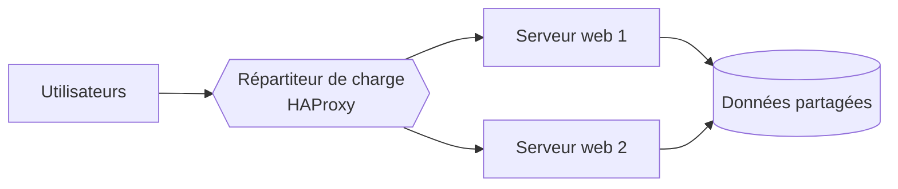

# Cours – Supervision, sauvegarde et haute disponibilité

*BTS SIO SISR 1re année – Bloc 2 – S16 – à lire avant le [TP](02-tp.md)*

> [!NOTE] Ce que tu dois savoir déjà
> - **Prérequis :** planifier une tâche avec `cron` et se connecter en SSH (S13), filtrer des flux et lire une capture (S15).
> - **Mots déjà vus :** service, port, cron, SSH, DMZ.
> - **Expliqués dans ce cours :** supervision et alerte, sonde et seuil, sauvegarde 3-2-1, RPO et RTO, haute disponibilité, répartition de charge.
> - **Trois notions voisines, trois objectifs différents :** ne les confonds pas (§ 1).

## À la fin de ce cours, tu sauras

- [ ] distinguer **supervision**, **sauvegarde** et **haute disponibilité** ;
- [ ] expliquer ce que mesure une **sonde**, un **seuil**, une **alerte** ;
- [ ] appliquer la règle de sauvegarde **3-2-1** et expliquer pourquoi **tester la restauration** est indispensable ;
- [ ] **calculer** et **interpréter** un RPO et un RTO ;
- [ ] expliquer la **répartition de charge** et la **tolérance de panne**.

---

## 1. Trois notions, trois questions

| Notion | Question à laquelle elle répond | Exemple |
|---|---|---|
| **Supervision** | « Est-ce que ça marche **maintenant** ? Le saurai-je avant les utilisateurs ? » | Une alerte quand le site web ne répond plus |
| **Sauvegarde** | « Si je perds les données ou le serveur, **puis-je revenir en arrière** ? » | Une copie chiffrée du dossier des utilisateurs |
| **Haute disponibilité** | « Le service peut-il **continuer** malgré la panne d'un élément ? » | Deux serveurs web derrière un répartiteur |

> [!WARNING]
> **Le RAID n'est pas une sauvegarde.** Il protège de la panne d'un disque, pas d'une suppression par erreur, d'un rançongiciel ou d'un incendie : la suppression est copiée instantanément sur tous les disques.

## 2. La supervision

**Superviser**, c'est surveiller en continu l'état des équipements et des services, et **prévenir** quand quelque chose sort de la normale.

| Élément | Définition | Exemple |
|---|---|---|
| **Hôte** | Machine ou équipement surveillé | Serveur web, switch, imprimante |
| **Sonde** (ou *item*) | Une mesure collectée régulièrement | Utilisation du processeur, port 80 ouvert, espace disque |
| **Seuil** | Valeur à partir de laquelle la mesure devient anormale | Disque plein à plus de 90 % |
| **Déclencheur** (*trigger*) | Condition « seuil franchi » | `service web = arrêté pendant 2 minutes` |
| **Alerte** | Message envoyé à un humain | Courriel, SMS, notification |

Deux manières de collecter : avec un **agent** installé sur la machine (il remonte les mesures, comme l'agent Zabbix), ou **sans agent** via un protocole d'interrogation : **SNMP** pour les équipements réseau (switch, routeur, imprimante), ou un simple test de port.

> [!TIP]
> **Une bonne alerte est actionnable.** Trop d'alertes inutiles finissent ignorées. On règle les seuils pour qu'un message signifie « quelqu'un doit agir », et on prévoit à qui il est envoyé.

Outils courants : **Zabbix** (complet, avec agents), **Nagios** et ses dérivés, **Centreon**, **Prometheus** associé à Grafana, **Uptime Kuma** (surveillance de disponibilité simple). Le principe est le même partout.

**Je vérifie.** Un serveur de fichiers est « disponible » (il répond au ping) mais ses utilisateurs ne peuvent plus enregistrer. Quelle sonde aurait permis de le voir ?

Voir la réponse

Une sonde sur l'**espace disque libre** (disque plein) : le serveur répond au ping alors que son service est dégradé. Une bonne supervision surveille le **service rendu** (port, espace, charge), pas seulement la présence de la machine.

## 3. La sauvegarde

### La règle 3-2-1

| Chiffre | Règle |
|---|---|
| **3** | Trois exemplaires des données (l'original et deux copies) |
| **2** | Sur deux types de supports différents (disque local, NAS, bande, nuage) |
| **1** | Dont une copie **hors site** (autre bâtiment, autre lieu, nuage) |

### Types de sauvegarde

| Type | Contenu | Avantage | Inconvénient |
|---|---|---|---|
| **Complète** | Tout | Restauration simple | Longue, volumineuse |
| **Différentielle** | Les changements depuis la dernière complète | Restauration en 2 étapes | Grossit au fil des jours |
| **Incrémentale** | Les changements depuis la dernière sauvegarde (quelle qu'elle soit) | Rapide, petite | Restauration en chaîne : plus longue |

### Une sauvegarde non testée n'existe pas

Une sauvegarde n'a de valeur que si on **sait restaurer**. On teste donc régulièrement : restaurer dans un dossier à part, comparer à l'original, **mesurer le temps** que cela prend.

> [!WARNING]
> Une copie qui reste connectée et modifiable (un dossier partagé en lecture-écriture, par exemple) peut être chiffrée en même temps que l'original par un rançongiciel. Au moins une copie doit être **hors ligne ou en lecture seule**.

## 4. RPO et RTO

Deux chiffres que le client **fixe** et que l'administrateur **tient** :

| Sigle | Nom | Question |
|---|---|---|
| **RPO** | *Recovery Point Objective* : perte de données maximale admise | « Combien de **temps de travail** puis-je perdre ? » |
| **RTO** | *Recovery Time Objective* : durée maximale d'interruption admise | « Combien de temps le service peut-il être **arrêté** ? » |

**Exemple.** Une sauvegarde est faite chaque nuit à 2 h. La panne survient à 15 h : on perd **13 h** de travail. Au pire (panne juste avant 2 h), on perd **près de 24 h**. Le RPO réel de cette stratégie est donc d'environ **24 h**. Si le client exige un RPO d'une heure, il faut des sauvegardes plus fréquentes ou une réplication.

**Je vérifie.** Un client exige un RPO de 4 heures et un RTO de 1 heure. Une sauvegarde complète est faite chaque nuit ; la restauration complète prend 3 heures. La stratégie convient-elle ?

Voir la réponse

**Non, sur les deux points.** Avec une sauvegarde quotidienne, on peut perdre jusqu'à 24 h (RPO de 4 h non tenu). La restauration dure 3 h (RTO de 1 h non tenu). Il faut des sauvegardes plus fréquentes (incrémentales toutes les 4 h, par exemple) et une restauration plus rapide, ou une solution de **haute disponibilité** qui évite la restauration.

## 5. La haute disponibilité

La **disponibilité** est la part du temps où le service est utilisable. On l'exprime en pourcentage :

| Disponibilité | Arrêt toléré par an (environ) |
|---|---|
| 99 % | 3 jours et 15 heures |
| 99,9 % | 8 heures 45 |
| 99,99 % | 52 minutes |

La **haute disponibilité** (HA) supprime les **points uniques de défaillance** : si un élément tombe, un autre prend le relais.

| Technique | Principe | Exemple |
|---|---|---|
| **Redondance** | Doubler un élément | Deux alimentations, deux cartes réseau, RAID |
| **Répartition de charge** (*load balancing*) | Un **répartiteur** distribue les demandes entre plusieurs serveurs identiques | Deux serveurs web derrière HAProxy |
| **Bascule** (*failover*) | Un serveur de secours prend le relais d'un serveur en panne | Adresse IP flottante entre deux machines (VRRP, *keepalived*) |
| **Test de santé** (*health check*) | Le répartiteur vérifie que chaque serveur répond et retire celui qui tombe | `check` dans la configuration HAProxy |

> [!NOTE]
> **Le répartiteur est lui-même un point unique de défaillance** : pour une vraie haute disponibilité, il est doublé (deux répartiteurs partageant une adresse IP flottante). C'est le sujet de la deuxième année ; ici, on observe la bascule des **serveurs** derrière un répartiteur.

**Je vérifie.** Deux serveurs web derrière un répartiteur gardent chacun une copie **locale** des sessions des utilisateurs. Quel problème se pose quand un serveur tombe ?

Voir la réponse

Les utilisateurs connectés au serveur tombé **perdent leur session** et doivent se reconnecter. Pour l'éviter, on partage les sessions (base de données, cache partagé) ou on les stocke côté client.

## À retenir

- **Supervision** (savoir), **sauvegarde** (revenir en arrière), **haute disponibilité** (continuer) : trois réponses à trois questions.
- **3-2-1** et **restauration testée** : sans test, pas de sauvegarde.
- **RPO** = perte de données tolérée ; **RTO** = interruption tolérée. Ils se **calculent** à partir de la stratégie réelle.
- La haute disponibilité **supprime les points uniques de défaillance**, y compris le répartiteur lui-même.
