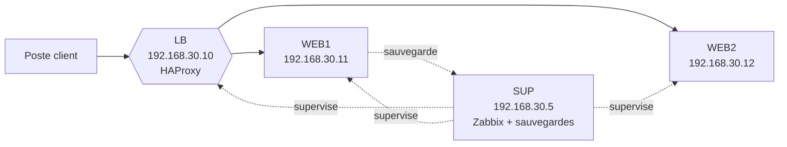

# TP – Superviser, sauvegarder et rendre un site web tolérant aux pannes

*BTS SIO SISR 1re année – Bloc 2 – S16 – binôme : un tape, l'autre lit ; on échange les rôles à chaque partie*

> [!NOTE]
> **But.** Le site web de la PME SimIO doit rester accessible, même quand un serveur tombe, et l'équipe doit **être prévenue** avant les utilisateurs. Tu construis deux serveurs web derrière un **répartiteur de charge**, tu **supervises** l'ensemble avec Zabbix, puis tu mets en place une **sauvegarde** dont tu **testes la restauration**. Tu termines en mesurant le **RTO** et en calculant le **RPO** de ton installation.
>
> **Durée :** 3 h 15 (parties A à E), plus le bilan. **Prérequis :** [cours S16](01-cours.md) lu.

> [!NOTE]
> **Comment ce TP fonctionne.** Avant de manipuler, tu écris ce que tu **anticipes** (« J'anticipe »). Puis tu testes et tu notes ce que tu **constates**. Les **commandes sont données** quand on ne peut pas les deviner ; ton travail est de **comprendre** ce qu'elles font (« Je comprends »). Un **bilan de compétences** clôt la séance.

**Binôme :** ____________ / ____________

> [!WARNING]
> **Environnement réel.** Ce TP se fait sur **quatre machines virtuelles Debian** : c'est ce qui lui permet d'alimenter une [fiche de réalisation](../../ressources/fiche-realisation-professionnelle.md). Les mots de passe indiqués sont des **identifiants de laboratoire** (environnement contrôlé) ; ne les reprends pas dans une réalisation présentée à l'épreuve.

## Contraintes

- Les adresses ci-dessous sont imposées.
- Chaque mesure (temps, nombre de requêtes perdues) est **notée avec son heure**.
- Une sauvegarde n'est comptée que si elle a été **restaurée avec succès** dans un dossier de test.

## Le réseau à construire



| Machine | Rôle | Adresse |
|---|---|---|
| **SUP** | Supervision (Zabbix) et dépôt des sauvegardes | `192.168.30.5/24` |
| **LB** | Répartiteur de charge (HAProxy) | `192.168.30.10/24` |
| **WEB1**, **WEB2** | Serveurs web (Apache) | `192.168.30.11/24`, `192.168.30.12/24` |

Toutes sont sur un même réseau interne VirtualBox nommé `srv`. Le poste client est ton poste (ou une 5e VM) sur ce réseau, avec l'adresse `192.168.30.50/24`.

> [!TIP]
> **Préparation avec Internet.** Les réseaux internes de VirtualBox n'ont pas d'accès à Internet. Installe d'abord les paquets avec la carte en **NAT** : `apache2` sur WEB1 et WEB2, `haproxy` sur LB, `rsync` et `tcpdump` partout, puis passe les cartes en réseau interne `srv`. L'installation de Zabbix (partie C) demande un accès au dépôt Zabbix : fais-la aussi **avant** de couper Internet (ou utilise les VM préparées).

---

## Partie A – Deux serveurs web reconnaissables (≈ 15 min)

**But :** deux serveurs dont on sait distinguer les réponses.

1. Sur WEB1 : `echo "<h1>Serveur WEB1</h1>" | sudo tee /var/www/html/index.html`.
2. Sur WEB2 : `echo "<h1>Serveur WEB2</h1>" | sudo tee /var/www/html/index.html`.
3. Depuis le poste client, vérifie : `curl http://192.168.30.11` et `curl http://192.168.30.12`.

**Point de contrôle :** chaque serveur répond avec son nom. ______________________

---

## Partie B – Haute disponibilité : un répartiteur de charge (≈ 50 min)

**But :** un seul point d'entrée, deux serveurs derrière, et la bascule automatique quand l'un tombe.

1. Sur LB, remplace le contenu de `/etc/haproxy/haproxy.cfg` par :

   ```text
   global
       log /dev/log local0
       maxconn 2000

   defaults
       mode http
       log global
       timeout connect 5s
       timeout client 30s
       timeout server 30s

   frontend web
       bind *:80
       default_backend serveurs

   backend serveurs
       balance roundrobin
       option httpchk GET /
       server web1 192.168.30.11:80 check
       server web2 192.168.30.12:80 check

   listen stats
       bind *:8404
       stats enable
       stats uri /stats
   ```

2. Vérifie la syntaxe : `sudo haproxy -c -f /etc/haproxy/haproxy.cfg`, puis `sudo systemctl restart haproxy`.
3. Depuis le client : lance 6 fois `curl -s http://192.168.30.10`.

**J'anticipe.** Que vas-tu voir dans les 6 réponses ? Et si tu arrêtes Apache sur WEB1 puis refais 6 requêtes ? ______________________

<details markdown="1">
<summary>Éléments de réponse</summary>

Avec `balance roundrobin`, les réponses **alternent** : WEB1, WEB2, WEB1, WEB2… Après l'arrêt d'Apache sur WEB1, le test de santé (`check`) détecte la panne au bout de quelques secondes et le répartiteur n'envoie plus rien à WEB1 : toutes les réponses viennent de WEB2, **sans que l'utilisateur n'ait à changer d'adresse**.

</details>

4. Ouvre la page de statistiques `http://192.168.30.10:8404/stats` : repère les deux serveurs (en vert).
5. **Mesure le RTO de la bascule.** Sur le client, lance une boucle qui interroge chaque seconde et note l'heure :

   ```bash
   while true; do echo "$(date +%T) $(curl -s --max-time 2 http://192.168.30.10 || echo ECHEC)"; sleep 1; done
   ```

   Pendant que la boucle tourne, sur WEB1 : `sudo systemctl stop apache2`. Note :
   - l'heure de l'arrêt : ______ ;
   - le nombre de lignes `ECHEC` éventuelles : ______ ;
   - l'heure où toutes les réponses viennent de WEB2 : ______ ;
   - **la durée d'interruption perçue (RTO mesuré)** : ______ .
6. Relance Apache sur WEB1 (`sudo systemctl start apache2`) : combien de temps avant qu'il reçoive de nouveau des requêtes ? ______ .

**Je comprends.**

| Question | Réponse |
|---|---|
| Que fait `option httpchk GET /` ? | ______________________ |
| Que se passe-t-il si **les deux** serveurs sont arrêtés ? | ______________________ |
| Quel élément reste un **point unique de défaillance** dans cette architecture ? | ______________________ |

<details markdown="1">
<summary>Éléments de réponse</summary>

- `option httpchk GET /` : le répartiteur envoie lui-même une requête HTTP `GET /` à chaque serveur à intervalle régulier ; un serveur qui ne répond pas correctement est retiré de la rotation.
- Si les deux sont arrêtés, HAProxy répond `503 Service Unavailable` : il n'y a plus de serveur à qui transmettre.
- **LB** : s'il tombe, plus personne n'atteint le site. On le double avec une adresse IP flottante (VRRP, *keepalived*). De même, les deux serveurs web partagent la **même** ressource réseau et le même hyperviseur : une vraie HA les répartit sur des machines physiques différentes.

</details>

---

## Partie C – Supervision : voir avant que les utilisateurs appellent (≈ 60 min)

**But :** un tableau de bord et une **alerte** quand le service web ou un serveur tombe.

> [!WARNING]
> Les commandes d'installation de Zabbix **dépendent de la version**. Utilise la page officielle `zabbix.com/download` (choisir la version LTS, **Debian 12**, base **MySQL** (MariaDB), serveur web **Apache**) et copie les commandes qu'elle affiche pour ajouter le dépôt et installer. Les étapes ci-dessous donnent la **logique** et les commandes stables ; la salle peut fournir une VM SUP déjà installée.

1. **Installer** sur SUP, selon la page officielle : le serveur Zabbix, l'interface web, la configuration Apache et l'agent (paquets `zabbix-server-mysql zabbix-frontend-php zabbix-apache-conf zabbix-sql-scripts zabbix-agent`) et `mariadb-server`.
2. **Créer la base** (commandes `mysql` en `root`) :

   ```sql
   create database zabbix character set utf8mb4 collate utf8mb4_bin;
   create user zabbix@localhost identified by 'MotDePasseTP';
   grant all privileges on zabbix.* to zabbix@localhost;
   set global log_bin_trust_function_creators = 1;
   ```

3. **Importer le schéma** (la commande demande le mot de passe) :

   ```bash
   zcat /usr/share/zabbix-sql-scripts/mysql/server.sql.gz | mysql --default-character-set=utf8mb4 -uzabbix -p zabbix
   ```

   Puis dans `mysql` : `set global log_bin_trust_function_creators = 0;`.
4. Dans `/etc/zabbix/zabbix_server.conf`, renseigne `DBPassword=MotDePasseTP`. Redémarre : `sudo systemctl restart zabbix-server zabbix-agent apache2` et active-les au démarrage (`enable`).
5. Ouvre `http://192.168.30.5/zabbix` depuis le client et suis l'assistant. **Change le mot de passe du compte `Admin` par défaut** dès la première connexion.
6. **Installer l'agent** sur LB, WEB1 et WEB2 (`zabbix-agent`) et renseigner dans `/etc/zabbix/zabbix_agentd.conf` : `Server=192.168.30.5`, `ServerActive=192.168.30.5`, `Hostname=web1` (le nom exact de l'hôte), puis `sudo systemctl restart zabbix-agent`.
7. Dans l'interface : **Collecte de données → Hôtes → Créer un hôte** pour chaque machine (nom identique au `Hostname`, interface agent, IP de la machine), avec le modèle **Linux by Zabbix agent**.

**J'anticipe.** Si tu arrêtes l'agent sur WEB2, quelle alerte attends-tu, et au bout de combien de temps environ ? ______________________

<details markdown="1">
<summary>Éléments de réponse</summary>

Le modèle *Linux by Zabbix agent* contient un déclencheur du type « **Zabbix agent is not available** » : il se déclenche après quelques minutes sans réponse de l'agent (délai paramétré dans le modèle). Le délai est volontairement non nul : il évite les fausses alertes sur une coupure de quelques secondes.

</details>

8. **Créer une sonde du service web** sur l'hôte `web1` : **Éléments → Créer** : nom `Web actif`, type *Agent Zabbix*, clé `net.tcp.service[http,,80]`, intervalle `10s`. La valeur est `1` si le service répond, `0` sinon.
9. **Créer le déclencheur** : **Déclencheurs → Créer** : nom `Apache arrêté sur web1`, gravité *Haute*, expression `last(/web1/net.tcp.service[http,,80])=0`.
10. **Provoquer la panne** : `sudo systemctl stop apache2` sur WEB1. Relève dans **Surveillance → Problèmes** : l'heure du problème : ______ ; sa gravité : ______ . Redémarre Apache et note l'heure de résolution : ______ .

> [!NOTE]
> **Notification par courriel (facultatif).** Un déclencheur ne prévient personne tant qu'une **action** n'est pas associée à un **type de média** (courriel, messagerie instantanée…). Avec un serveur SMTP de test fourni par l'enseignant, crée un type de média *Courriel* puis une action « envoyer un message à l'utilisateur `Admin` quand un problème est de gravité Haute ».

**Je comprends.**

| Question | Réponse |
|---|---|
| Quelle est la différence entre un **élément** (sonde), un **déclencheur** et une **action** ? | ______________________ |
| Pourquoi superviser le **port 80** et pas seulement le ping ? | ______________________ |
| Quel est l'intérêt d'un **délai** avant l'alerte ? | ______________________ |

<details markdown="1">
<summary>Éléments de réponse</summary>

- L'**élément** collecte une mesure, le **déclencheur** décide qu'elle est anormale (condition sur la mesure), l'**action** décide **qui est prévenu et comment**.
- Un serveur peut répondre au ping alors que son service est arrêté : seule la sonde du **service** reflète ce que vivent les utilisateurs.
- Éviter les fausses alertes (un redémarrage rapide, une coupure réseau d'une seconde) qui, répétées, finissent ignorées.

</details>

**Point de contrôle :** capture datée du tableau de bord avec le problème `Apache arrêté sur web1` visible, puis résolu.

---

## Partie D – Sauvegarde et restauration testée (≈ 45 min)

**But :** une sauvegarde automatique du site de WEB1 vers SUP, **restaurée** pour prouver qu'elle sert.

1. **Préparer l'accès** de WEB1 à SUP par clé SSH (comme en S13). La sauvegarde sera lancée par `cron` **en tant que root** : la clé doit donc être celle de root. Sur WEB1 : `sudo ssh-keygen -t ed25519`, puis `sudo ssh-copy-id sauvegarde@192.168.30.5` (compte `sauvegarde` créé sur SUP avec `sudo adduser sauvegarde`).
2. Sur SUP, crée le dépôt : `sudo mkdir -p /srv/sauvegardes/web1 && sudo chown sauvegarde /srv/sauvegardes/web1`.
3. Sur WEB1, écris le script `/usr/local/bin/sauvegarde-web.sh` :

   ```bash
   #!/bin/bash
   # Sauvegarde du site et de la configuration Apache
   DATE=$(date +%Y%m%d-%H%M)
   ARCHIVE="/tmp/web1-$DATE.tar.gz"
   tar czf "$ARCHIVE" /var/www /etc/apache2 || exit 1
   rsync -a "$ARCHIVE" sauvegarde@192.168.30.5:/srv/sauvegardes/web1/ || exit 1
   rm -f "$ARCHIVE"
   logger -t sauvegarde-web "Sauvegarde $DATE terminée"
   ```

   Rends-le exécutable (`sudo chmod +x`) et lance-le une fois à la main.
4. **Planifie-le** avec `sudo crontab -e` : une sauvegarde **toutes les 15 minutes** pour le TP (en production : selon le RPO) :

   ```text
   */15 * * * * /usr/local/bin/sauvegarde-web.sh
   ```

5. **Simule un sinistre** sur WEB1 : `sudo rm -rf /var/www/html/*` ; vérifie que `curl http://192.168.30.11` ne renvoie plus la page.
6. **Restaure** : copie la dernière archive depuis SUP, extrais-la **dans un dossier de test**, compare, puis remets en place.

   ```bash
   sudo scp sauvegarde@192.168.30.5:/srv/sauvegardes/web1/web1-AAAAMMJJ-HHMM.tar.gz /tmp/
   mkdir /tmp/restauration && tar xzf /tmp/web1-AAAAMMJJ-HHMM.tar.gz -C /tmp/restauration
   ls /tmp/restauration/var/www/html
   sudo cp -a /tmp/restauration/var/www/html/. /var/www/html/
   ```

7. Note :
   - l'heure du sinistre : ______ ;
   - l'heure où le site est de nouveau servi : ______ ;
   - **la durée de restauration (RTO de la restauration)** : ______ .

**J'anticipe.** Si le sinistre survient 10 minutes après la dernière sauvegarde, que perds-tu ? Quel RPO la planification toutes les 15 minutes garantit-elle au pire ? ______________________

<details markdown="1">
<summary>Éléments de réponse</summary>

Tu perds **10 minutes** de modifications du site. Au pire (sinistre juste avant la sauvegarde suivante), on perd **15 minutes** : le **RPO garanti** est de 15 minutes. Pour un RPO plus faible, il faut sauvegarder plus souvent (ou répliquer en continu).

</details>

**Je comprends.**

| Question | Réponse |
|---|---|
| Pourquoi restaurer d'abord **dans un dossier de test** ? | ______________________ |
| Cette configuration respecte-t-elle la règle **3-2-1** ? Que manque-t-il ? | ______________________ |
| Pourquoi la sauvegarde ne doit-elle **pas** être montée en lecture-écriture sur WEB1 ? | ______________________ |

<details markdown="1">
<summary>Éléments de réponse</summary>

- On vérifie que l'archive est **lisible et complète** sans écraser ce qui reste en production ; on mesure aussi le temps.
- **Non** : il y a l'original et **une** copie sur un seul support. Il manque une deuxième copie sur un autre support et **une copie hors site**.
- Un rançongiciel qui chiffre WEB1 chiffrerait aussi le dossier de sauvegarde monté en écriture. Avec `rsync` vers un compte distant et un dépôt non monté, l'attaquant n'a pas d'accès direct à l'historique (à renforcer : droits en ajout seulement, copie hors ligne).

</details>

---

## Partie E – Bilan chiffré : RPO et RTO de ton installation (≈ 15 min)

Reporte tes mesures :

| Indicateur | Valeur mesurée ou calculée | Comment |
|---|---|---|
| **Disponibilité** quand un serveur web tombe (interruption perçue) | ______ | Partie B, mesure à la seconde |
| **Délai de détection** de la panne par la supervision | ______ | Partie C |
| **RPO garanti** de la sauvegarde | ______ | Partie D, fréquence du `cron` |
| **RTO de la restauration** | ______ | Partie D |

**Question de synthèse.** Un client demande **RPO 1 h et RTO 15 min** pour son site. Ton installation convient-elle ? Si non, que modifies-tu (au moins deux changements) ? ______________________

<details markdown="1">
<summary>Éléments de réponse</summary>

Réponse type : la **haute disponibilité** (partie B) tient largement le RTO de 15 min pour la panne d'un serveur web (quelques secondes). En revanche, la **sauvegarde toutes les 15 minutes** tient le RPO de 1 h, mais la restauration complète ne doit pas dépasser 15 min : à vérifier avec la mesure. À améliorer : doubler le répartiteur (adresse IP flottante), ajouter une deuxième copie hors site (règle 3-2-1), superviser aussi l'**âge de la dernière sauvegarde**, et partager les données qui changent entre les deux serveurs web.

</details>

## Pour aller plus loin

- **SNMP :** superviser un switch ou une imprimante du simulateur ou de la salle avec le modèle SNMP de Zabbix.
- **Sauvegarde des bases :** ajoute `mysqldump` pour la base de données et restaure-la.
- **Adresse IP flottante :** installe `keepalived` sur deux répartiteurs pour supprimer le dernier point unique de défaillance.

## Retour en entreprise (si ta situation le permet)

- **Observer :** quelle solution de supervision l'entreprise utilise-t-elle ? Qui reçoit les alertes ? Quand a eu lieu la dernière **restauration testée** ?
- **Documenter :** reporte le RPO et le RTO réellement tenus, comparés à ceux attendus.
- **Réaliser :** avec l'accord de ton tuteur, ajoute une sonde sur un service existant.

## Rendu

Compte rendu **PDF**, nommé `RENDU-B2-S16-NOM.pdf`, contenant : la configuration HAProxy commentée, la mesure de bascule, les captures datées de Zabbix (problème et résolution), le script de sauvegarde, la preuve de restauration, le tableau de la partie E et tes réponses aux questions « J'anticipe » et « Je comprends ».

## Bilan de la séance

Remplis ce bilan **seul**, honnêtement : il sert à décider ce qu'il faut reprendre. Niveau : **Non maîtrisé**, **Maîtrise partielle**, **Bonne maîtrise** ou **Excellente maîtrise** (le vocabulaire des grilles nationales d'évaluation) ; **Non évalué** si tu n'as pas travaillé la compétence aujourd'hui.

| Compétence du référentiel | Ce que j'ai fait dans cette séance | Niveau |
|---|---|---|
| **B2.3** – Exploiter, dépanner et superviser une solution d'infrastructure réseau | | |
| **B3.4** – Garantir la disponibilité, l'intégrité et la confidentialité des services informatiques et des données de l'organisation face à des cyberattaques | | |
| **B3.5A** – Assurer la cybersécurité d'une infrastructure réseau, d'un système, d'un service | | |

> [!NOTE]
> Les codes sont ceux du [référentiel](../../ressources/referentiel.md) (l'arrêté numérote des activités : les codes « B… » sont un usage courant). Le choix des compétences pour cette séance est une proposition de l'enseignant, **à valider**.

**Je sais faire, sans aide :**

- [ ] Distinguer supervision, sauvegarde et haute disponibilité ;
- [ ] Superviser un service avec alertes (sondes et seuils) ;
- [ ] Mettre en place une sauvegarde 3-2-1 et tester une restauration ;
- [ ] Calculer RPO et RTO pour une situation donnée ;
- [ ] Répartir la charge entre deux serveurs web et observer la bascule en cas de panne.

**Ce que je dois reprendre :** ______________________

**Ma question à poser à l'enseignant :** ______________________
